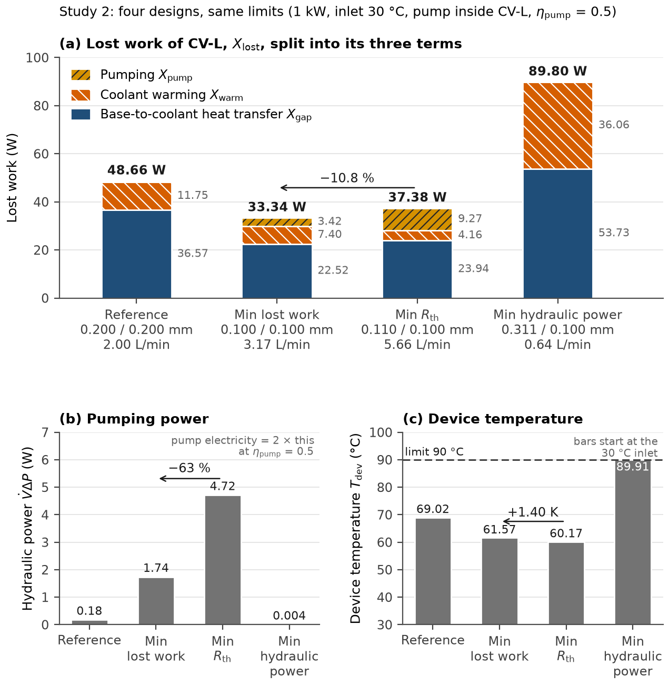
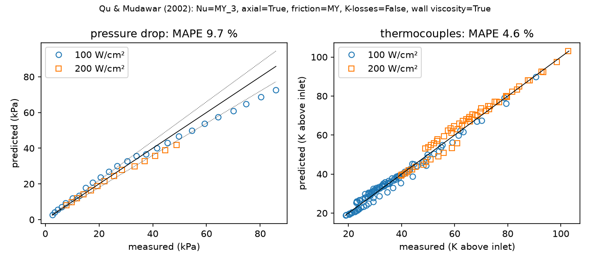
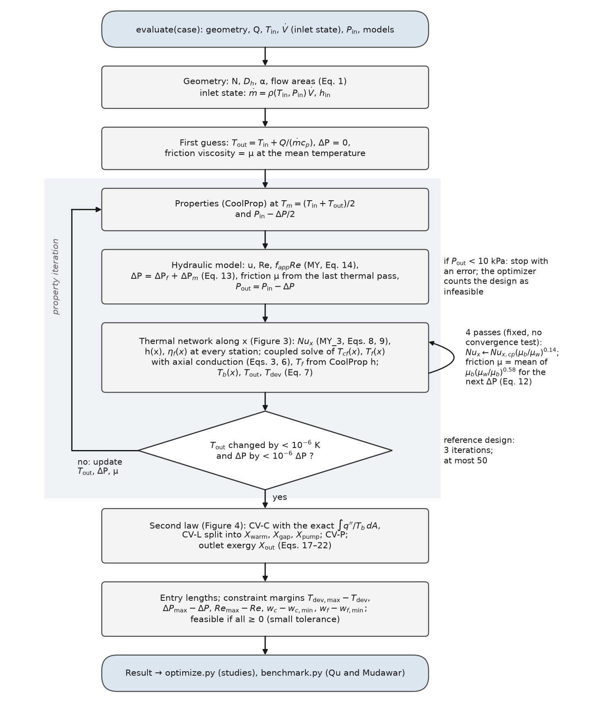

# Second-Law Analysis and Constrained Optimization of a Liquid-Cooled Cold Plate for a 1 kW Electronic Heat Source

AI processors now dissipate close to 1 kW, and their cold plates are usually sized by minimizing thermal resistance, a criterion that always asks for more coolant flow. This project asks how much flow, and what channel geometry, is actually worth it once friction is counted as well. We built a steady, reduced-order Python model of a water-cooled copper microchannel cold plate (1 kW on 30 × 30 mm, water properties from CoolProp), validated it without tuning against the experiments of Qu and Mudawar (2002), and used entropy generation and lost work (exergy destruction) to choose the channel width, fin thickness and flow rate under device-temperature, pressure-drop and laminar-flow limits. The full write-up is [docs/final_report.md](docs/final_report.md) (Word version: [docs/final_report.docx](docs/final_report.docx)).

MEEN 615 (Advanced Engineering Thermodynamics), Texas A&M University, Fall 2026.

## Headline result

Minimum lost-work design against the minimum thermal resistance design, same constraints (T_dev ≤ 90 °C, ΔP ≤ 50 kPa, Re ≤ 2000, widths ≥ 0.1 mm), 1 kW, 30 °C water inlet ([analysis/results/study2_designs.csv](analysis/results/study2_designs.csv), report Table 18):

| Design | w_c (mm) | w_f (mm) | N | V̇ (L/min) | ΔP (kPa) | Ẇ_hyd (W) | X_lost (W) | T_dev (°C) |
|---|---|---|---|---|---|---|---|---|
| Reference | 0.200 | 0.200 | 75 | 2.00 | 5.3 | 0.18 | 48.66 | 69.02 |
| **Minimum lost work** | 0.100 | 0.100 | 150 | 3.17 | 32.9 | 1.74 | 33.34 | 61.57 |
| Minimum thermal resistance | 0.110 | 0.100 | 142 | 5.66 | 50.0 (at the limit) | 4.72 | 37.38 | 60.17 |

**The lost-work design uses 63.2 % less pumping power and has 10.8 % less lost work, for a device 1.40 K hotter.** The savings are those of report Tables 8 and 23 ([analysis/results/phase1_pump_cv.csv](analysis/results/phase1_pump_cv.csv), the same optimization rerun in the Phase 1 checks with the widths snapped to 1 nm); the rounded Study 2 rows above give 63.1 %, 10.8 % and +1.40 K. They assume the pump inside the control volume with an assumed pump efficiency of 0.5; with the pump outside, the pumping-power saving is 40.6 %.

Other results (report sections 9, 10 and 12):

- At the reference geometry the lost work is lowest at 5.13 L/min (43.05 W); the estimate V̇* = (B/2C)^(1/3) gives 4.77 L/min.
- Heat transfer from the base to the coolant is the largest loss, so geometry is worth about twice as much as flow: optimizing the geometry cuts lost work by 22.5 %, optimizing the flow alone by 11.5 %.
- The cold plate alone (CV-C) has no useful optimum flow: its entropy generation is flat within 0.5 % from 0.5 to 4.5 L/min. The optimum appears only when the return of the coolant to its inlet temperature is included (CV-L).
- At the reference geometry the lost-work optimum stays feasible up to a 55 °C inlet; between 55 and 57.5 °C the 90 °C device limit takes over.



*Study 2: lost work by term, hydraulic power and device temperature for the four designs (report Figure 14).*

## Validation

Model run at the Qu and Mudawar (2002) geometry and test conditions, with no coefficient tuned (report Table 14):

| Quantity | Points | Selected model | Proposal's fully developed model |
|---|---|---|---|
| Thermocouple temperature rise above the inlet | 157 | **4.6 %** MAPE | 49.1 % |
| Water temperature rise | 38 | 2.8 % | 2.9 % |
| Pressure drop (plenum to plenum, no plenum losses) | 39 | **9.7 %** | 21.4 % |

Selected model: Muzychka–Yovanovich simultaneously developing flow with three heated walls (`MY_3`), axial conduction in the base, bulk-to-wall viscosity correction, and `MY` apparent friction. The proposal's fully developed model failed because the benchmark channels are short compared with the thermal entry length. After an independent recheck of the data, one marker moved to "partly hidden" and the thermocouple MAPE is 4.61 % on 156 points.



*Parity plots for the selected model: pressure drop (left) and thermocouple rise above the inlet (right) (report Figure 11).*

## Install

Python 3.10 or newer. From the repository folder:

Windows (PowerShell):

```powershell
python -m venv .venv
.\.venv\Scripts\activate
pip install -r requirements.txt
pip install -e .
$env:OPENBLAS_NUM_THREADS=1
```

Linux / macOS:

```bash
python -m venv .venv
source .venv/bin/activate
pip install -r requirements.txt
pip install -e .
```

`OPENBLAS_NUM_THREADS=1` stops NumPy from threading the many small solves of the thermal network; on Windows it halved the test time (47 → 24 min). If PowerShell blocks `activate`, call the interpreter directly, e.g. `.\.venv\Scripts\python.exe -m pytest -q`.

## Run

These are the commands of report section 11.2 and Appendix C. All scripts overwrite their output files.

```bash
# tests (the digitizer test needs Node.js and is skipped without it)
python -m pytest -q

# validation
python validation/run_validation.py                                   # model matrix (report Tables 6, 7)
python validation/run_validation.py --skip-matrix --plots MY_3 1 MY 0 1   # parity plot, Figure 11 (about 5 min)
python validation/run_validation.py --skip-matrix --vs-re             # data and model against Re, Figure 10
python -c "from coldplate.benchmark import compare; r = compare(include_minor=False); print(r['MAPE_TC'], r['MAPE_thermal'], r['MAPE_dP'])"

# design studies
python analysis/run_studies.py                 # Studies 1-5 (--only N runs one study, --quick uses coarser grids)
python analysis/run_phase1_checks.py           # robustness checks; or name parts: d7 d5 fd num digit cap

# figures
python analysis/make_report_figures.py         # Figures 3-9 and 12-17 (or one: B C D E F G H I J1 J2 J3 J4 J5)
python analysis/make_geometry_figures.py       # Figures 1-2

# report: Markdown to Word
pip install pypandoc_binary python-docx
python tools/export_docx.py                    # writes docs/final_report.docx; --word-pdf adds Word's page count (Windows + Word)
```

Cautions (report Appendix C): `run_validation.py` without options reruns the full matrix on the 156 points left after the recheck, so the numbers can differ slightly from Tables 6 and 7 (157 points). Do not regenerate `validation/data/*.csv` without need: the digitizer needs Node.js, Poppler (`pdftoppm`) and the paper's PDF, and `fill_csv.py` rewrites the benchmark CSVs.

One case from Python:

```python
from coldplate.config import Case, lpm
from coldplate.model import evaluate
from coldplate.optimize import with_design, optimum_flow

r = evaluate(Case())                                       # 1 kW reference design (0.2 / 0.2 mm, 2 L/min, 30 °C)
print(r.summary())                                         # T_dev, dP, lost work, ... in report units
r2 = evaluate(with_design(Case(), w_c=0.15e-3, V_dot=lpm(3.0)))
print(optimum_flow(Case()).V_dot * 60000)                  # lost-work optimum flow, L/min
```

## How the code fits together

```
config → geometry → correlations → hydraulic + thermal → second_law → model.evaluate → optimize / benchmark
```

`model.evaluate()` derives the geometry once, then iterates properties → pressure drop → thermal network until the outlet temperature and ΔP stop changing, and finally computes the second-law terms and the constraint margins. `optimize.py` (studies) and `benchmark.py` (Qu and Mudawar, inputs read only from `validation/data/`, never from `config.py`) reach the physics only through `evaluate()`; no study or validation script repeats any physics. SI units everywhere inside the package; °C, L/min and mm only in CSV columns, plots and `Result.summary()`.



*How `model.evaluate()` solves one case: the coupling of properties, hydraulics and the thermal network (report Figure 6).*

## Repository map

| Path | Contents |
|---|---|
| `coldplate/config.py` | the 1 kW design case as dataclasses, the selected models, `lpm()` / `to_lpm()` |
| `coldplate/properties.py` | CoolProp wrapper for water |
| `coldplate/geometry.py` | channel count, hydraulic diameter, aspect ratio, areas |
| `coldplate/correlations.py` | Nusselt models (`fd_H1`, `fd_H1_3`, `LG`, `LG_3`, `MY`, `MY_3`) and friction models (`fd`, `MY`, `hagenbach`), each with its source |
| `coldplate/hydraulic.py` | pressure drop, Re, hydraulic power, pump electricity |
| `coldplate/thermal.py` | station-by-station thermal network with axial conduction and the wall-viscosity correction |
| `coldplate/second_law.py` | entropy generation for the three control volumes, lost work, flow exergy |
| `coldplate/model.py` | `evaluate(case)`: coupled solution → `Result` |
| `coldplate/optimize.py` | flow sweep, optimum flow, grid + SLSQP design optimization, inlet-temperature sweep |
| `coldplate/benchmark.py` | Qu and Mudawar case from `validation/data/`; `predict()`, `compare()` |
| `tests/` | pytest suite (8 files) |
| `validation/README.md` | benchmark inputs, data status, comparison rules |
| `validation/data/` | benchmark geometry, conditions, sensors and digitized points (CSV, with a status for every value) |
| `validation/data/raw/` | digitizer output (raw points, overlay images, calibration) and `recheck_log.md` |
| `validation/digitize/` | digitizing pipeline (headless WebPlotDigitizer core) |
| `validation/results/` | MAPE of every thermal (24) and friction (12) model combination |
| `validation/run_validation.py` | model matrix, parity and against-Re plots |
| `analysis/run_studies.py` | Studies 1–5 |
| `analysis/run_phase1_checks.py` | robustness checks: pump placement, plenum K, fully developed model, numerics, digitizing uncertainty, flow cap |
| `analysis/make_report_figures.py`, `analysis/make_geometry_figures.py` | report figures from the CSVs |
| `analysis/results/` | study and check results (CSV) |
| `figures/` | all figures (PNG) |
| `docs/final_report.md`, `docs/final_report.docx` | final report and its Word export |
| `docs/equation_sheet.md` | equations, sources, validity ranges, assumptions |
| `docs/proposal_submitted.md` | the submitted proposal (scope and objectives) |
| `docs/project_status.md` | what is done, what is open |
| `docs/presentation_outline.md` | slide-by-slide outline of the final talk |
| `docs/design_case_justification.md` | design values against published cold plates |
| `docs/project_scope.md`, `docs/future_extensions.md` | scope of the course project, ideas beyond it |
| `tools/export_docx.py` | report Markdown → Word (pandoc + python-docx) |

## Limitations

- **Aspect-ratio extrapolation.** The model is validated at H/w_c = 3.1; the design case has H/w_c = 15 (reference) to 30 (the 0.1 mm optimum). The fully developed model gives the same optimum geometry, but the design numbers are an extrapolation of the validation.
- **Plenum loss coefficients have no source.** K_c = 0.5 and K_e = 1.0 are assumed. On the benchmark the pressure drop agrees best with no plenum losses (9.7 %) and over-predicts by 27 % with K = 1. The lost-work design hardly changes for K_c + K_e = 0–3; the size of the pumping saving does (61–66 %).
- **Uniform heat flux.** No hot spots and one-dimensional base conduction, so a real chip's hottest point would be hotter than T_dev.
- **Equal flow in every channel.** No manifold or maldistribution model.
- **CV-L idealizes the coolant distribution unit** as a reservoir at the inlet temperature, with the heat not reused. This is why the optimum (about 3.2 L/min per kW) is above the 1–2 L/min per kW of current practice; capping the flow at 2 L/min costs 6.1 % more lost work with the same geometry.

Open items (independent hand calculation of the reference design, viscosity exponents and Shah and London fits checked against the original sources, reference [12]) are listed in [docs/project_status.md](docs/project_status.md).

## Course

MEEN 615, Advanced Engineering Thermodynamics, Texas A&M University, Fall 2026. Instructor: Prof. Dion Antao.

## How to cite / data sources

To cite this work: "Second-Law Analysis and Constrained Optimization of a Liquid-Cooled Cold Plate for a 1 kW Electronic Heat Source," MEEN 615 final report (group project; authors on the report's title page), Texas A&M University, Fall 2026. Code: https://github.com/krishna24558/coldplate-egm.

- **Validation data.** The measurements of W. Qu and I. Mudawar, "Experimental and numerical study of pressure drop and heat transfer in a single-phase micro-channel heat sink," Int. J. Heat Mass Transfer 45 (2002) 2549–2565, are **digitized from the paper's Figs. 4(a), 5, 6(a) and 6(b)**; the paper reports them only as figures. The PDF is not included in this repository (publisher copyright; `validation/data/raw/*.pdf` is ignored by Git). The data have been checked by the pipeline's own cross-checks and by an independent recheck ([validation/data/raw/recheck_log.md](validation/data/raw/recheck_log.md)), and by an independent hand check of 24 points read by hand in WebPlotDigitizer (all within 1 % of the axis span). Status, units and paper location of every value: [validation/README.md](validation/README.md).
- **Water properties:** CoolProp (I. H. Bell et al., Ind. Eng. Chem. Res. 53 (2014) 2498–2508).
- **Correlations:** sources, equation numbers and validity ranges in [docs/equation_sheet.md](docs/equation_sheet.md) and report section 14.
- **Licences:** the code is MIT ([LICENSE](LICENSE)); the WebPlotDigitizer core in `validation/digitize/wpd_core/` is AGPL-3.0 (its own licence file).
