# Second-Law Analysis and Constrained Optimization of a Liquid-Cooled Cold Plate for a 1 kW Electronic Heat Source

MEEN 615: Advanced Engineering Thermodynamics, Fall 2026, Final Report\
Group: Sai Krishna Kommineni, Suneel Kumar, Sam\
Instructor: Prof. Dion Antao

<!-- Report status: sections 1-8 drafted 2026-11-16; sections 9, 10, 12, 13 drafted 2026-11-20; abstract, section 11, appendices A-C, figure captions and the flow-cap check added 2026-11-22. All 17 figures exist in figures/. Numbers come from docs/project_status.md, validation/README.md, validation/data/raw/recheck_log.md and the CSVs in analysis/results/ and validation/results/. -->

## 1. Abstract

AI processors now dissipate close to 1 kW, and their cold plates are usually sized by minimizing thermal resistance, which always asks for more coolant flow. We used the second law to find how much flow, and what channel geometry, is worth it. We built a reduced-order Python model of a water-cooled copper microchannel cold plate for a 1 kW, 30 × 30 mm heat source and validated it against the experiments of Qu and Mudawar (2002). The fully developed model of our proposal failed (49 % thermocouple error). With developing-flow correlations, three-sided heating, axial conduction in the base and a wall-viscosity correction, and no tuning, the errors are 4.6 % for temperature and 9.7 % for pressure drop. Lost work was computed for the cold plate plus the return of the coolant to its inlet temperature. For 0.2 mm channels it is lowest at 5.13 L/min (analytical estimate 4.77 L/min). Optimizing channel width, fin thickness and flow together gives 0.1 mm channels and fins at 3.17 L/min. Against the minimum thermal resistance design, this uses 63 % less pumping power and has 10.8 % less lost work, for a device 1.40 K hotter (41 % less pumping power if the pump is left outside the control volume). Heat transfer from the base to the coolant is the largest loss, so geometry matters more than flow. At the 0.2 mm geometry the optimum stays feasible up to a 55 °C inlet; above that, the 90 °C device limit takes over.

## 2. Introduction and objective

AI processors now dissipate close to 1 kW from a die of about 30 mm by 30 mm, so data centers are moving from air cooling to direct-to-chip liquid cooling. In a liquid-cooled server the chip sits under a copper cold plate with many narrow channels, and water (or a water mixture) is pumped through them. Microchannels remove high heat fluxes with a small temperature rise [2], but narrow channels and high flow also mean a high pressure drop.

Cold plates are usually sized by minimizing the thermal resistance between the chip and the coolant. The problem with this criterion is that it always asks for more flow. Two losses compete in a cold plate:

- heat crossing a finite temperature difference between the chip and the water, which more flow reduces, and
- viscous friction in the channels, which more flow increases.

Thermal resistance only sees the first one. The second law puts both on the same scale, because both produce entropy, and entropy generation times the environment temperature is lost work (Gouy-Stodola theorem). This is Bejan's entropy generation minimization [3], which has been applied to microchannel heat sinks before [4].

We think the second-law view is useful for liquid cooling of AI chips for three reasons, all taken from our proposal:

1. Pumping power is only a few watts for one chip, but it grows quickly with flow, and dozens of cold plates in a rack share one pump loop.
2. More flow cannot fix a bad geometry, because it only reduces one of the resistances between chip and water.
3. Data centers want warmer coolant to save chiller energy (ASHRAE liquid-cooling classes [5]), which reduces the temperature margin of the chip. A lost-work analysis shows how the optimum changes when the inlet gets warmer and when the temperature limit takes over.

**Central question (from the proposal).** How much coolant flow is thermodynamically worthwhile before the extra friction losses outweigh the reduction in heat-transfer irreversibility, and how do the channel geometry, the device temperature limit and the coolant inlet temperature change that optimum?

**Objectives (from the proposal).**

1. Build a model that gives device temperature, pressure drop and pump power for any channel width, fin thickness and flow rate.
2. Validate it against the measured data of Qu and Mudawar (2002) [1].
3. Calculate entropy generation, split it into its sources, and express it as lost work.
4. Find the flow and geometry that minimize lost work under the constraints and compare with the minimum thermal resistance design.
5. Find the highest inlet temperature at which the optimum is still feasible, and the exergy of the outlet water.

Sections 4 to 8 cover objectives 1 and 2 and the modelling choices behind objectives 3 and 4. Sections 9 and 10 cover objectives 3 to 5. Section 11 describes the code, and sections 12 and 13 give the conclusions, the limitations and future work. Appendix A collects the assumptions, Appendix B checks the report against every promise of the proposal, and Appendix C gives the commands that reproduce each number and figure.

## 3. What we did, step by step

**Step 1: proposal.** We proposed a steady, one-dimensional thermal resistance model of a water-cooled copper microchannel cold plate for a 1 kW, 30 mm × 30 mm heat source. The proposal used the fully developed laminar Nusselt number and friction factor for rectangular ducts [6], a standard fin efficiency [7] and water properties from CoolProp [8]. The second-law control volume was the cold plate plus the return of the coolant to its inlet temperature. The validation target was Qu and Mudawar (2002) [1] with errors within about 10 to 15 %. The proposal also named a fallback: "if the error is too large we will switch to a developing-flow Nusselt correlation."

**Step 2: baseline model.** We coded the proposal's model in Python as a small package (`coldplate/`): geometry, correlations, hydraulic model, thermal model, second-law terms, and one function `evaluate()` that solves a case. Each equation was written in `docs/equation_sheet.md` with its source before it was coded, and each module has tests (property values, limits of the correlations, energy balance, positive entropy generation and others).

**Step 3: validation.** Qu and Mudawar report their measurements only as figures, so we digitized their Figs. 4(a), 5 and 6 (section 7) and ran our model at their geometry and test conditions. The proposal's fully developed model failed: the mean absolute percentage error (MAPE) was 49 % on the thermocouple temperature rises and 44 % on the pressure drop (with plenum loss coefficients of 1). The reason is that their channels are short compared with the thermal entry length, so the heat transfer coefficient near the inlet is several times the fully developed value. This was the case the proposal's fallback was written for.

**Step 4: model changes.** We coded the developing-flow correlations of Lee and Garimella [9] and Muzychka and Yovanovich [10], three-sided heating, axial conduction in the copper base, a wall-viscosity correction and apparent (developing) friction. We compared 24 thermal and 12 friction combinations against the data without tuning any coefficient (section 6). The selected model has a thermocouple MAPE of 4.6 % and a pressure-drop MAPE of 9.7 %, both inside the proposal's target.

**Step 5: recheck of the data.** The digitized points and the values taken from the paper's text were rechecked independently (section 7.6). No data value changed.

**Step 6: design studies.** With the validated model as the default we ran the studies of the proposal on the 1 kW case (flow sweep, constrained optimization against the minimum thermal resistance design, inlet temperature sweep, sensitivities) and some extra checks (pump inside or outside the control volume, plenum loss coefficient, channels below the 0.1 mm bound, numerical convergence, digitizing uncertainty, a flow cap of 2 L/min). The results are in sections 9 and 10; sections 4 to 8 use them only where they justify a modelling choice.

Table 1 lists what changed from the proposal and why.

**Table 1.** Changes from the submitted proposal.

| Item | Proposal | Final | Why |
|---|---|---|---|
| Nusselt number | fully developed, four walls heated (Shah and London) | local, simultaneously developing, three walls heated (`MY_3`) | fully developed model gave 49 % thermocouple MAPE on the benchmark; the selected model gives 4.6 % |
| Friction | fully developed fRe | apparent friction for developing flow (`MY`) | 21.4 % → 9.7 % ΔP MAPE (together with the viscosity correction, no plenum losses) |
| Viscosity | at the mean water temperature | bulk-to-wall viscosity correction | in the benchmark the walls are 20–40 K above the water, so friction was over-predicted |
| Base conduction | 1D, straight down | 1D down plus axial conduction along the base | smooths the wall temperature near the inlet, where h is very high; 2–3 MAPE points |
| Thermal model | one lumped resistance chain | the same chain solved station by station along the channel | needed because h now depends on x |
| Validation target | 10–15 % | met: 4.6 % (thermal), 9.7 % (ΔP) | – |
| First estimate of the optimum flow at 0.2 mm | 4 to 5 L/min | 5.13 L/min (validated model), 4.53 L/min (fully developed model) | with developing flow h rises with velocity, so the optimum moves to higher flow |
| Inlet temperature sweep | 20 to 50 °C | 20 to 60 °C | the device limit takes over between 55 and 57.5 °C, above the proposal's range |
| Extra studies | – | minimum hydraulic power design, pump inside/outside the control volume, plenum K, channels below 0.1 mm, flow capped at 2 L/min, numerical checks, digitizing uncertainty | open questions that came up during the work |

What did not change: the 1 kW case, the design variables and their ranges, the constraints, the objective (lost work in the control volume CV-L), the comparison design (minimum thermal resistance) and the benchmark.

## 4. Geometry and design case

### 4.1 The 1 kW design case

The design case is not one specific product. We picked the inputs to represent a current AI accelerator under a skived-fin copper cold plate. Figure 1 shows the plate and its cross-section, and Table 2 lists the values (they are stored in `coldplate/config.py`).

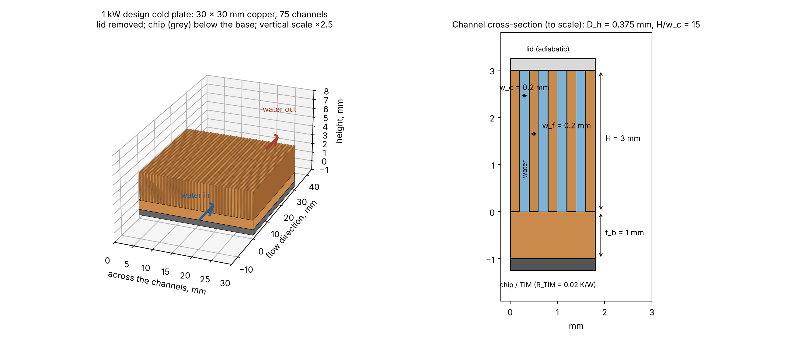

**Figure 1.** The 1 kW design-case cold plate at the reference geometry (0.2 mm channels and fins, 75 channels). Left: 3D view with the lid removed and the chip below the base (vertical scale × 2.5). Right: channel cross-section to scale, D_h = 0.375 mm, H/w_c = 15 (`figures/geometry_3d_design.png`).

**Table 2.** Design-case inputs.

| Quantity | Value | Type |
|---|---|---|
| Heat load Q | 1000 W, uniform over 30 mm × 30 mm (about 111 W/cm²) | fixed |
| Plate material | copper, k_s = 390 W/m·K | fixed |
| Channel length L and plate width W | 30 mm × 30 mm (the heated footprint) | fixed |
| Fin / channel height H | 3 mm | fixed (so the optimization has three variables) |
| Base thickness t_b | 1 mm | fixed |
| Channel width w_c | reference 0.2 mm, range 0.1–1.0 mm | design variable |
| Fin thickness w_f | reference 0.2 mm, range 0.1–0.5 mm | design variable |
| Flow rate | reference 2 L/min, range 0.5–12 L/min | design variable |
| Coolant, inlet temperature | water, 30 °C (Study 3: 20–60 °C) | fixed / swept |
| Junction + TIM resistance R_TIM | 0.02 K/W (about 20 K at full power) | assumed, varied in the sensitivity study |
| Device temperature limit | 90 °C | constraint (assumed) |
| Pressure-drop limit | 50 kPa | constraint (assumed) |
| Reynolds number limit | 2000 (laminar) | constraint |
| Plenum loss coefficients | K_c = 0.5, K_e = 1.0 | assumed, no source; varied 0–3 |
| Pump efficiency | 0.5 | assumed, varied 0.3–0.7 |
| Dead state T0 | 25 °C | assumed |

R_TIM, the 90 °C limit, the 50 kPa budget, the K values and the pump efficiency are our assumptions. We do not have a primary source for them, so we treat them as assumptions and vary R_TIM, K and the pump efficiency in the sensitivity studies.

### 4.2 Comparison with published cold plates

To check that the design case is realistic we compared it with published values (Table 3, from `docs/design_case_justification.md`).

**Table 3.** Design-case values against published or industry values.

| Our value | Published / industry value | Source |
|---|---|---|
| Copper plate, skived-fin style straight channels | copper base and skived microchannels are the dominant data-center cold plate design | Shedd [15] |
| w_c = 0.2 mm, w_f = 0.2 mm (optimizer down to 0.1 mm) | fins and gaps historically limited to about 100 µm, state of the art about 50 µm; worked examples use 100 and 200 µm gaps | Shedd [15] |
| | W_ch = W_fin = 0.2 mm baseline in a microchannel cold plate model | Wang et al. [16] |
| Fin height H = 3 mm | 3 mm to about 7 mm for very thin fins | Shedd [15] |
| | ≥ 3 mm fin height reported for the NVIDIA GB200 cold plate (blog claim) | FiberMall [17] |
| Base thickness 1 mm | 1–3 mm for GPU/CPU cold plates | Shedd [15] |
| L = 30 mm, footprint 30 × 30 mm | L_ch = 30 mm | Wang et al. [16] |
| 1 kW on 9 cm² = 111 W/cm² | 100 W/cm² footprint flux; packages "climbing past 1500 W" | Wang et al. [16]; Shedd [15] |
| Inlet water 30 °C (sweep 20–60 °C) | 45 °C inlet with PG25 coolant reported for GB200 (blog claim); ASHRAE classes W17–W45 | FiberMall [17]; ASHRAE [5] |
| ΔP limit 50 kPa | < 20 kPa cold plate pressure drop reported for GB200 (blog claim) | FiberMall [17] |
| 2 L/min reference flow | 1.8 L/min per GB200 cold plate (blog claim) | FiberMall [17] |

Three cautions about Table 3. The FiberMall numbers are a vendor blog's claims without a primary source, so we use them only as "typical" values. The paper of Wang et al. models a two-phase (R515B) cold plate, but its channel geometry is the same family as ours. Manufacturers do not publish full drawings, so our design is a representative skived-fin plate inside the published ranges and not a copy of a commercial part.

### 4.3 Design case and benchmark side by side

The benchmark heat sink of Qu and Mudawar [1] has a different geometry: 21 channels of 231 µm × 713 µm in a 1.0 cm × 4.48 cm copper block (section 7). Figure 2 compares the two unit cells and their dimensionless numbers. Most numbers of the design case fall inside the range of the experiment; the exception is the aspect ratio (H/w_c = 15 against 3.1). We come back to this in section 8.5.

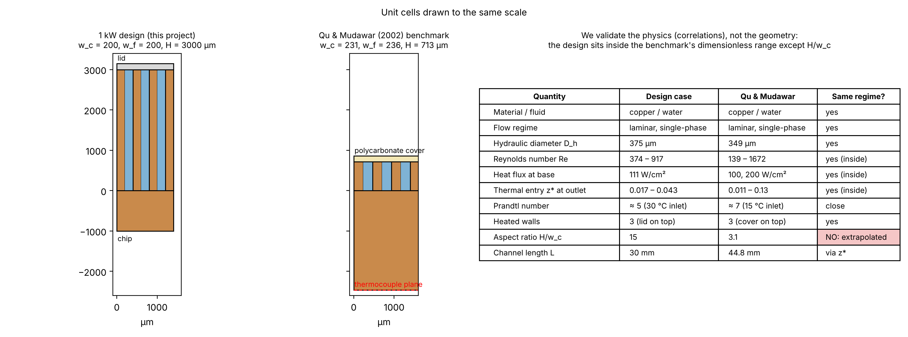

**Figure 2.** Unit cells of the design case and of the Qu and Mudawar heat sink, drawn to the same scale, with the dimensionless numbers of both; the aspect ratio is the one quantity outside the benchmark's range (`figures/geometry_design_vs_qm.png`).

## 5. Model

The model is steady, single-phase and reduced-order. It takes a geometry (w_c, w_f, H, L, W, t_b), a heat load, an inlet state and a flow rate, and returns temperatures, pressure drop, pumping power and the entropy-generation terms. All equations are in SI units; temperatures in the entropy terms and in CoolProp calls are in kelvin. The full list with sources is in `docs/equation_sheet.md`; the equations below are the ones the final model uses. Figure 5 shows how the code is organised and Figure 6 how one case is solved.

### 5.1 Geometry and flow

For straight fins across a plate of width W, the number of channels, hydraulic diameter and aspect ratio are

$$N = \left\lfloor \frac{W}{w_c + w_f} \right\rfloor, \qquad D_h = \frac{2 w_c H}{w_c + H}, \qquad \alpha = \frac{\min(w_c, H)}{\max(w_c, H)} \tag{1}$$

The flow is assumed to split equally between the channels (assumption A5), so the channel velocity and Reynolds number are

$$u = \frac{\dot V}{N w_c H}, \qquad Re = \frac{\rho u D_h}{\mu} \tag{2}$$

### 5.2 Thermal network along the channel

The proposal's model was one chain of resistances (coolant warming, convection, base conduction, TIM) evaluated at the outlet. Because the heat transfer coefficient now changes along the channel, we solve the same chain at stations along x (Figure 3). The stations are clustered toward the inlet, where h changes fastest; the default is 41 stations for the design case and 61 for the benchmark.

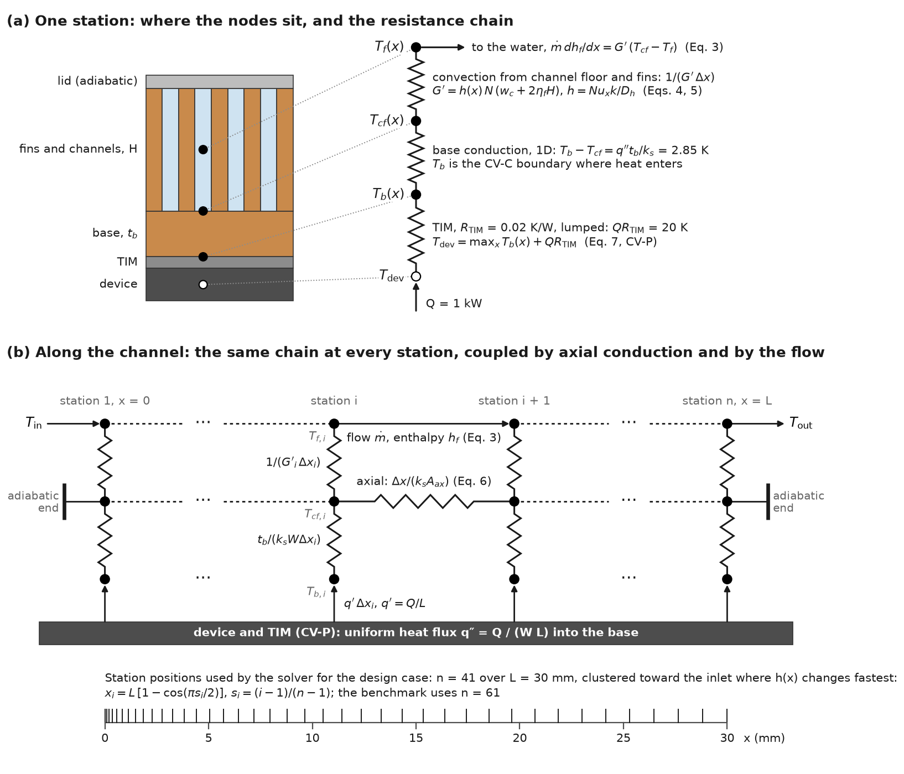

**Figure 3.** Thermal network. (a) One station: where the nodes T_dev, T_b, T_cf and T_f sit in the cross-section, and the resistance chain between them (TIM, lumped as Q R_TIM = 20 K on the hottest base point; base conduction, q″t_b/k_s = 2.85 K; convection from the channel floor and fins, 1/(G′Δx) with the local h(x)). (b) The same chain at every station along x, coupled by axial conduction between the T_cf nodes (adiabatic ends) and by the flow between the T_f nodes, with heat q′Δx entering each T_b node. The scale at the bottom shows the 41 station positions used for the design case, clustered toward the inlet (`figures/fig_B_network.png`).

*Fluid.* With a uniform heat flux the heat input per unit length is q′ = Q/L. The fluid energy balance uses the CoolProp enthalpy, and the outlet state follows from the first law:

$$\dot m \frac{dh_f}{dx} = G'(x)\,\big(T_{cf}(x) - T_f(x)\big), \qquad h_{out} = h_{in} + \frac{Q}{\dot m} \tag{3}$$

*Convection and fins.* T_cf is the temperature of the channel floor (the fin base). The local conductance per unit length of all N channels, with the channel floor and two fin faces per channel, is

$$G'(x) = h(x)\, N \big(w_c + 2\,\eta_f(x)\, H\big), \qquad h(x) = \frac{Nu_x\, k_f}{D_h} \tag{4}$$

$$\eta_f = \frac{\tanh(mH)}{mH}, \qquad m = \sqrt{\frac{2h}{k_s w_f}} \tag{5}$$

Eq. (5) is the standard straight fin with an adiabatic tip [7] (assumption A6: the lid is insulated).

*Base.* Without axial conduction, each station is independent and T_cf = T_f + q′/G′. With axial conduction (the default), the channel-floor temperature follows a one-dimensional conduction equation along the base with adiabatic ends:

$$k_s A_{ax} \frac{d^2 T_{cf}}{dx^2} - G'(x)\,\big(T_{cf} - T_f\big) + q' = 0 \tag{6}$$

where A_ax is the base cross-section normal to the flow direction. Eqs. (3) and (6) are solved together as a small coupled finite-volume system.

*Base surface and device.* The temperature of the heated base surface and the hottest device point are

$$T_b(x) = T_{cf}(x) + \frac{Q}{W L}\,\frac{t_b}{k_s}, \qquad T_{dev} = \max_x T_b(x) + Q\,R_{TIM} \tag{7}$$

For the benchmark the same expression gives the copper temperature at the thermocouple plane, with t_b replaced by the thermocouple depth d = 2.462 mm below the channel bottom and R_TIM = 0 (section 7).

*Nusselt number.* The selected model (`MY_3`) is the Muzychka and Yovanovich model for simultaneously developing laminar flow [10], which uses the square root of the flow area as the length scale:

$$Nu_{\sqrt A}(z^*) = \left[ \left( \frac{C_4 f(Pr)}{\sqrt{z^*}} \right)^{m} + \left( \left\{ C_1 \frac{fRe_{\sqrt A}}{8\sqrt{\pi}\,\varepsilon^{\gamma}} \right\}^{5} + \left\{ C_2 C_3 \left( \frac{fRe_{\sqrt A}}{z^*} \right)^{1/3} \right\}^{5} \right)^{m/5} \right]^{1/m} \tag{8}$$

with z* = z/(√A Re_√A Pr), C1 = 3.86 and C3 = 0.501 (uniform wall flux), C2 = C4 = 1 (local value), γ = 1/10, m = 2.27 + 1.65 Pr^(1/3) and f(Pr) = 0.886/[1 + (1.909 Pr^(1/6))^(9/2)]^(2/9) ([10], Eqs. 21, 22, 42–46 and Table 1). It is stated for 0.1 < Pr < ∞ and all z*, with an accuracy of about ±15 %. In the code the result is converted to a D_h basis.

Eq. (8) is for a duct heated on all four walls. Our channels (and the benchmark's) are heated on three walls, with an insulated lid. We correct for this with the ratio of the fully developed three-wall and four-wall Nusselt numbers:

$$Nu_{x,3} = Nu_x\, \frac{Nu_{fd,3}}{Nu_{fd,4}} \tag{9}$$

$$Nu_{fd,4} = 8.235\,(1 - 2.0421\alpha + 3.0853\alpha^2 - 2.4765\alpha^3 + 1.0578\alpha^4 - 0.1861\alpha^5) \tag{10}$$

$$Nu_{fd,3} = 8.235\,\left(1 - \frac{1.883}{a} + \frac{3.767}{a^2} - \frac{5.814}{a^3} + \frac{5.361}{a^4} - \frac{2.0}{a^5}\right), \qquad a = H/w_c \ge 1 \tag{11}$$

Eqs. (10) and (11) are the Shah and London fits [6] (Eq. 11 as quoted in Eq. 16 of Lee and Garimella [9]). Eq. (9) is Eq. (15) of Lee and Garimella [9], who use it with their own developing-flow correlation. Applying the same ratio to the Muzychka-Yovanovich model is our extension, and we flag it as such.

*Wall-viscosity correction.* Water viscosity falls with temperature, and the wall is hotter than the bulk. We use the property-ratio method for laminar liquids (Kays and Crawford [13]):

$$\frac{Nu}{Nu_{cp}} = \left(\frac{\mu_b}{\mu_w}\right)^{0.14}, \qquad \frac{f}{f_{cp}} = \left(\frac{\mu_w}{\mu_b}\right)^{0.58} \ \text{(heating)} \tag{12}$$

with μ_b at the local water temperature T_f(x) and μ_w at T_cf(x). The exponents are taken as tabulated in the `ht` Python library; we have not yet checked them in the original table (section 8.6).

### 5.3 Hydraulic model

The pressure drop is channel friction plus inlet and outlet (plenum) losses:

$$\Delta P = \Delta P_f + \Delta P_m, \qquad \Delta P_f = \frac{2\,(f_{app}Re)\,\mu\, u\, L}{D_h^2}, \qquad \Delta P_m = (K_c + K_e)\,\frac{\rho u^2}{2} \tag{13}$$

with the Fanning friction factor. In Eq. (13) μ is the length mean of the corrected viscosity μ_b(μ_w/μ_b)^0.58 from Eq. (12). The apparent friction factor for developing flow from a uniform inlet velocity is ([10], Eqs. 47 and 21)

$$f_{app}Re_{\sqrt A} = \left[ \left( \frac{3.44}{\sqrt{z^+}} \right)^2 + \big(fRe_{\sqrt A}\big)^2 \right]^{1/2}, \qquad z^+ = \frac{z}{\sqrt A\, Re_{\sqrt A}} \tag{14}$$

$$fRe_{\sqrt A} = \frac{12}{\sqrt{\varepsilon}\,(1+\varepsilon)\left[1 - \dfrac{192\,\varepsilon}{\pi^5}\tanh\!\left(\dfrac{\pi}{2\varepsilon}\right)\right]} \tag{15}$$

where ε is the aspect ratio. The hydraulic power and the estimated pump electricity are

$$\dot W_{hyd} = \dot V\,\Delta P, \qquad \dot W_{elec} = \frac{\dot V\,\Delta P}{\eta_{pump}} \tag{16}$$

These two are different quantities and we keep them apart: Ẇ_hyd is the flow work the cold plate consumes; Ẇ_elec includes the losses inside the pump, with an assumed efficiency.

### 5.4 Property handling

- Water properties (ρ, μ, k, c_p, Pr, h, s) come from CoolProp [8]. The inlet pressure is 2 bar (assumed; it only affects the properties slightly).
- The correlations use properties at the mean water temperature, and the viscosity correction of Eq. (12) uses the local bulk and wall temperatures.
- The outlet temperature comes from the outlet enthalpy, T_out = T(h_out, P_out), not from a constant c_p.
- Because properties, pressure drop and outlet temperature depend on each other, `evaluate()` iterates them until T_out changes by less than 10⁻⁶ K. This takes 3 iterations for the reference design.
- Viscous heating is not added to T_out (about ΔP/(ρc_p), under 0.01 K here), but the pressure drop does enter the entropy balance because s is evaluated at (T, P).

### 5.5 Second-law terms and control volumes

We use three control volumes and keep them separate (Figure 4).

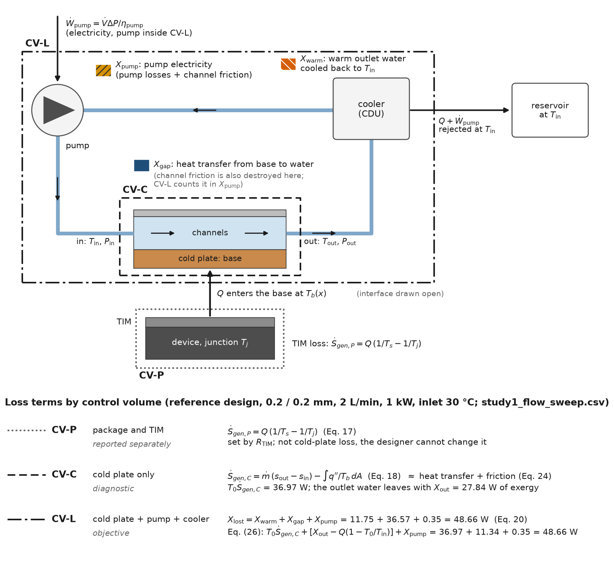

**Figure 4.** Control volumes: CV-P (package and TIM, dotted), CV-C (cold plate only, dashed) and CV-L (cold plate, pump and an idealized cooler that returns the water to T_in, dash-dot; the objective). Each CV-L loss term is tagged where it is destroyed: X_gap in the cold plate, X_pump at the pump, X_warm at the cooler. The device and TIM are drawn apart from the base only so that the three boundaries do not overlap. The key gives the reference-design values (0.2 / 0.2 mm, 2 L/min) from `study1_flow_sweep.csv`, including the link between CV-C and CV-L of Eq. (26): 36.97 + 11.34 + 0.35 = 48.66 W (`figures/fig_C_control_volumes.png`).

*CV-P, package and TIM.* Heat Q leaves the junction at T_j and enters the base at T_s. This loss belongs to the package, not to the cold plate, and is reported separately:

$$\dot S_{gen,P} = Q\left(\frac{1}{T_s} - \frac{1}{T_j}\right) \tag{17}$$

*CV-C, the cold plate.* Steady flow with one inlet and one outlet, heat entering through the base surface at the local temperature T_b:

$$\dot S_{gen,C} = \dot m\,(s_{out} - s_{in}) - \int \frac{q''}{T_b}\, dA \tag{18}$$

*CV-L, the cold plate plus the return to T_in (objective).* The warm outlet water is cooled back to T_in, and Q plus all pump work is rejected at T_in. This idealizes the coolant distribution unit as a reservoir at T_in; it is not a full loop model.

$$\dot S_{gen,L} = Q\left(\frac{1}{T_{in}} - \frac{1}{\bar T_s}\right) + \frac{\dot W_{pump}}{T_{in}}, \qquad X_{lost} = T_0\,\dot S_{gen,L} \tag{19}$$

Here T̄_s is the mean temperature at which heat enters the base, and X_lost is the lost work by the Gouy-Stodola theorem [3]. In the default model the pump is inside the control volume, so Ẇ_pump = Ẇ_elec (section 6.6). We split Eq. (19) at the mean water temperature T̄_f into three terms:

$$\dot S_{gen,L} = \underbrace{Q\left(\frac{1}{T_{in}} - \frac{1}{\bar T_f}\right)}_{\text{coolant warming}} + \underbrace{Q\left(\frac{1}{\bar T_f} - \frac{1}{\bar T_s}\right)}_{\text{base-to-coolant gap}} + \underbrace{\frac{\dot W_{pump}}{T_{in}}}_{\text{pumping}} \tag{20}$$

The warming term falls roughly as 1/V̇, and in laminar flow the pumping term grows as V̇². If we write X_warm ≈ B/V̇ and X_pump ≈ C V̇², and take the gap term as constant, the optimum flow is

$$\dot V^* \approx \left(\frac{B}{2C}\right)^{1/3}, \qquad B = \frac{T_0\,Q^2}{2\,\rho\, c_p\, T_{in}^2} \tag{21}$$

and at this optimum the warming loss is twice the pumping loss. We use Eq. (21) as a check on the numerical optimum, not as the result.

The flow exergy of the outlet water, relative to the dead state (T0, P0), is

$$\psi = (h - h_0) - T_0\,(s - s_0) \tag{22}$$

### 5.6 Code structure and solution procedure

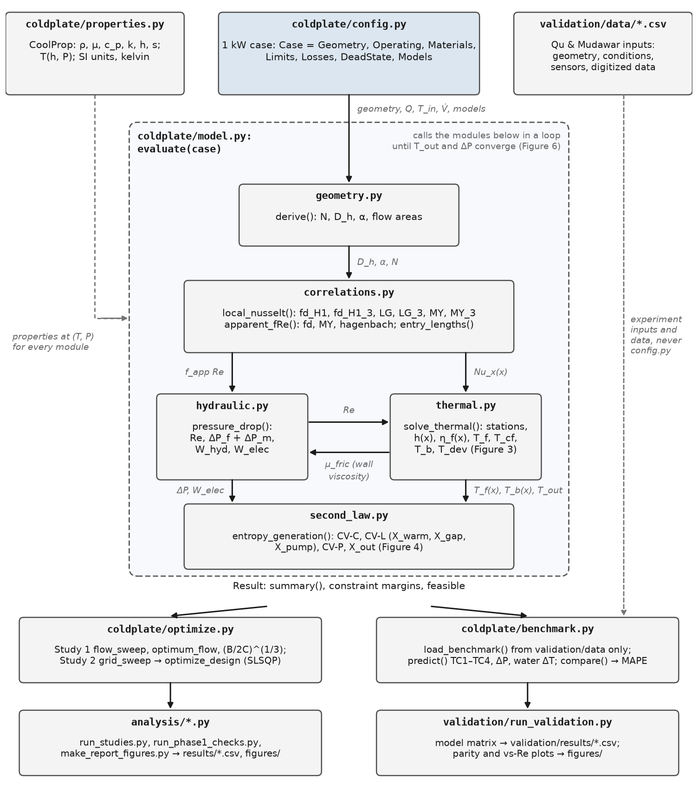

**Figure 5.** Code structure. `config.py` holds the 1 kW case; `model.evaluate()` (dashed box) calls `geometry.py` → `correlations.py` → `hydraulic.py` ⇄ `thermal.py` → `second_law.py`, with `properties.py` (CoolProp) as a side input to every module; the `Result` feeds `optimize.py` (studies) and `benchmark.py` (Qu and Mudawar, inputs from `validation/data/` only, never from `config.py`), which feed the analysis and validation scripts. Arrow labels name what is passed (`figures/fig_D_code_structure.png`).

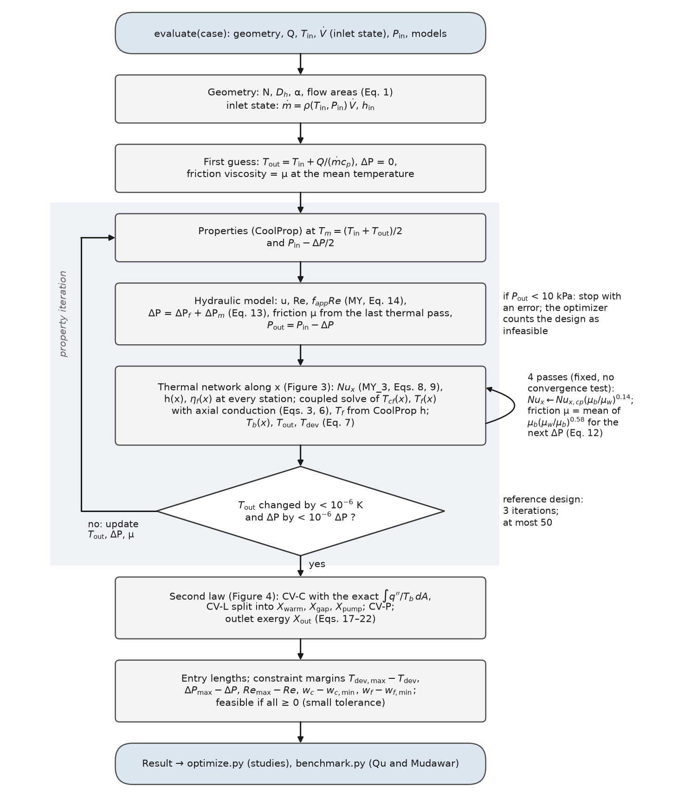

**Figure 6.** Solution of one case by `model.evaluate()`, as coded: first guess of T_out and ΔP → properties at the mean state → hydraulic model (stop with an error if P_out < 10 kPa) → thermal network with 4 fixed wall-viscosity passes → convergence test (T_out to 10⁻⁶ K and ΔP to 10⁻⁶ ΔP; 3 iterations for the reference design, at most 50) → second-law terms → entry lengths and constraint margins (`figures/fig_E_solver_flowchart.png`).

Section 11 describes each module, its inputs and outputs, and the tests. The numerical checks are in section 11.4: going from 41 to 81 stations changes T_dev of the reference design by 0.010 K and X_lost by 0.016 %, and tightening the iteration tolerance changes nothing that we report. One thing is not checked: the viscosity-correction loop uses a fixed 4 passes with no convergence test.

### 5.7 Assumptions

Table 4 lists the assumptions (IDs as in `docs/equation_sheet.md`) and where each one stands in the final model.

**Table 4.** Assumptions.

| ID | Assumption | Effect | Status in the final model |
|---|---|---|---|
| – | Steady, single-phase, laminar flow | sets the correlations we can use | laminar enforced by the Re ≤ 2000 constraint |
| A1 | Heat enters CV-C at one mean temperature | small bias in the entropy-transfer term | not needed: the code uses the exact integral of Eq. (18). For the reference design the mean-temperature boundary term Q/T̄_s differs from the integral by 0.006 %, and Ṡ_gen,C computed with it by 0.15 % |
| A2 | Uniform heat flux over the footprint | no hotspots; T_dev is under-predicted for real chips | accepted |
| A3 | 1D conduction through the base, no spreading | footprint equals heated area, so spreading is small | accepted for the 1 kW case |
| A4 | Hottest device point above the outlet | – | replaced: T_dev uses the maximum of T_b(x), Eq. (7) |
| A5 | Equal flow in every channel | no manifold maldistribution | accepted |
| A6 | Fin tip adiabatic (insulated lid); h uniform over fin and floor | three walls heated, not four | three-sided correction, Eq. (9) |
| A7 | Fully developed flow | – | **failed** in validation; replaced by developing-flow models, Eqs. (8) and (14) |
| A8 | Plenum loss coefficients K_c = 0.5, K_e = 1.0 | matter more at high Re | assumed, no source; sensitivity K = 0–3 |
| A9 | Pump efficiency 0.5 | scales Ẇ_elec and the pumping term of Eq. (19) | assumed; sensitivity 0.3–0.7 |
| A10 | No wall-viscosity correction | friction over-predicted by 20–40 % for the benchmark | replaced by Eq. (12) |
| A11 | Viscous heating ignored in T_out | under 0.01 K | accepted |
| A12 | R_TIM = 0.02 K/W, T_dev,max = 90 °C | set feasibility | assumed, no source |
| A13 | Dead state T0 = 25 °C | scales X_lost and ψ | assumed |
| A14 | No axial conduction in the base | misses smoothing of the wall temperature near the inlet | replaced by Eq. (6) |

## 6. Method and model selection

Every modelling choice below was made the same way: we coded the alternatives, ran all of them against the Qu and Mudawar data, and picked using the error and a physical reason. No coefficient was tuned to the data. The errors are mean absolute percentage errors (MAPE); for thermocouples the percentage is taken on the temperature rise above the inlet, not on °C, so it is not flattered by the 15 °C offset. Table 5 summarizes the choices and the sub-sections give the evidence.

**Table 5.** Summary of the choices.

| Choice | Selected | Alternatives tested | Main evidence |
|---|---|---|---|
| Nusselt model | `MY_3`: Muzychka-Yovanovich, simultaneously developing, three-sided | `fd_H1`, `fd_H1_3`, `LG`, `LG_3`, `MY` | 4.6 % against 49.1 % for the proposal's model (Table 6) |
| Heated walls | three (insulated lid) | four | 3–5 MAPE points better for the developing models |
| Base conduction | with axial conduction | 1D per station | about 2–3 MAPE points better for the developing models |
| Viscosity | bulk-to-wall correction | properties at the mean temperature only | 2–5 points thermally for the developing models; ΔP 34.6 % → 9.7 % |
| Friction | `MY` apparent friction | fully developed `fd`, `hagenbach` | 9.7 % against 15.8 % (Table 7) |
| Objective control volume | CV-L, pump inside | CV-C; CV-L with pump outside | CV-C has no useful optimum; pump placement changes the saving from 63 % to 41 % |
| Optimizer | grid, then SLSQP, then whole-channel polish | – | proposal's method plus a fix for the integer channel count |

### 6.1 Nusselt model: why developing flow, and why `MY_3`

The alternatives are:

- `fd_H1`: fully developed, four walls heated, Eq. (10). This is the proposal's model.
- `fd_H1_3`: fully developed, three walls heated, Eq. (11).
- `LG`: Lee and Garimella [9] local Nusselt number for thermally developing flow (their Eq. 12). It assumes the velocity profile is already developed at the inlet and was fitted for aspect ratios 1 ≤ H/w_c ≤ 10.
- `MY`: Muzychka and Yovanovich [10], Eq. (8), for simultaneously developing flow (velocity and temperature profiles both start at the inlet), any aspect ratio.
- `LG_3`, `MY_3`: the same with the three-sided correction of Eq. (9).

Table 6 gives the thermocouple MAPE for all 24 combinations with and without axial conduction and the viscosity correction (`validation/results/thermal_model_matrix.csv`, 157 points). Figure 7 shows why the fully developed models fail. At one benchmark condition (100 W/cm², Re = 900), the developing-flow models give a local Nusselt number at TC1, 5 mm from the inlet, of 11.0 (`MY_3`) and 10.5 (`LG_3`), 2.3 and 2.2 times the fully developed value of 4.85, and still 1.29 times it at the outlet. The thermal entry length from Lee and Garimella ([9], Eq. 11) is 92 mm at this condition, twice the 44.8 mm channel, so the whole channel is thermally developing.

**Table 6.** Thermocouple MAPE (%) of the 24 thermal model combinations. The water temperature rise (energy balance) is 2.8–2.9 % for every model.

| Nusselt model | 1D base | 1D base + wall viscosity | axial conduction | axial conduction + wall viscosity |
|---|---|---|---|---|
| `fd_H1` (proposal) | 49.1 | 38.1 | 50.3 | 39.3 |
| `fd_H1_3` | 40.6 | 31.2 | 41.8 | 32.2 |
| `LG` | 14.4 | 9.7 | 12.5 | 7.6 |
| `LG_3` | 9.8 | 6.5 | 7.5 | **4.5** |
| `MY` | 13.1 | 9.0 | 10.5 | 6.6 |
| `MY_3` | 9.2 | 6.4 | 6.7 | **4.6** |

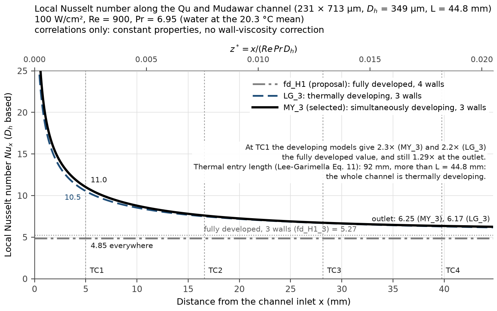

**Figure 7.** Local Nusselt number along the Qu and Mudawar channel for the three models as plotted: `fd_H1` (the proposal's fully developed, four-wall value), `LG_3` (Lee-Garimella, three walls) and `MY_3` (Muzychka-Yovanovich, three walls, selected). Condition: 100 W/cm², Re = 900, Pr = 6.95 (water at the 20.3 °C mean temperature of that run); correlations only, with constant properties and no wall-viscosity correction. The thin dotted line is the three-wall fully developed value `fd_H1_3` = 5.27; the vertical lines mark TC1–TC4 (`figures/fig_I_local_Nu.png`).

What Table 6 shows:

1. The fully developed assumption fails (49.1 %, and still 32–39 % with every other improvement added). The step to any developing-flow model is by far the largest one.
2. In every column the three-sided version is better than the four-sided one, and `MY` is slightly better than `LG` without the three-sided correction.
3. With all corrections, `LG_3` (4.5 %) and `MY_3` (4.6 %) are equally good. The difference is far smaller than the scatter of the data.

**Why `MY_3` over `LG_3`.** The data cannot separate them, so we chose on three other grounds:

- *Inlet condition.* The numerical model in the Qu and Mudawar paper uses a uniform velocity at the channel inlet (their Eq. 11), which is simultaneously developing flow. That is what the Muzychka-Yovanovich model describes. The Lee-Garimella correlation assumes a hydrodynamically developed inlet.
- *Aspect ratio.* The Lee-Garimella fit is valid for 1 ≤ H/w_c ≤ 10, and the code has to clip the aspect ratio to 10 outside it. Our 1 kW design has H/w_c = 15 to 30. The Muzychka-Yovanovich model has no aspect-ratio limit.
- *Bias.* With all corrections the mean bias is +0.7 % for `MY_3` and +2.4 % for `LG_3`, and the largest single error is 13.7 % against 15.1 %.

The cost of this choice is that `LG_3` is fully sourced (Eq. 15 of [9]) while the three-sided correction applied to `MY` is our own extension. We accept that because the two give the same accuracy on the benchmark and, as section 6.8 shows, the same design conclusions.

### 6.2 Three-sided heating

The benchmark's cover plate is polycarbonate (k = 0.2 W/m·K), and a real cold plate has a lid that is not heated, so three walls are heated and the top is close to adiabatic. Alternatives: four heated walls (the standard duct correlations) or the ratio correction of Eq. (9). Evidence from Table 6: the three-sided version is better by 4.6 points for `LG` and 3.9 points for `MY` without other corrections, and by 3.1 and 2.0 points with all corrections. Physical reason and evidence agree, so we use it. A reader may be surprised by Figure 7: at the benchmark aspect ratio (H/w_c = 3.1) the three-wall fully developed value of Eq. (11) is higher than the four-wall value of Eq. (10), 5.27 against 4.85, so the ratio in Eq. (9) is 1.09 and the three-sided correction raises h. For the design case (H/w_c = 15) the ratio is 1.01. For a square duct the fits give the opposite order (3.55 against 3.61). We use the values as the fits give them; the fits themselves have not been checked in the original source (section 7.7).

### 6.3 Axial conduction in the base

Near the inlet h is very high, so a model that conducts heat only straight down predicts a cold wall at the inlet. In the real copper block heat also flows along the base toward that cold region. Alternatives: 1D per station, or Eq. (6). Evidence from Table 6 (developing models): 1.9–2.6 points better without the viscosity correction and 1.8–2.4 points better with it. For the fully developed models it makes the error slightly worse (49.1 → 50.3 %), which only says that a wrong h is not repaired by a better conduction model. The effect is physical (the benchmark base is 5.6 mm of copper), so we keep it on. We did not isolate its effect on the 1 kW design, which has a 1 mm base.

### 6.4 Wall-viscosity correction

Alternatives: all properties at the mean water temperature (the proposal), or the property-ratio correction of Eq. (12). In the benchmark the walls run 20–40 K above the water, and water viscosity changes strongly over that range. Evidence:

- Thermal (Table 6): 2.1–4.9 points better for the developing models, about 10 points for the fully developed ones.
- Pressure drop (Table 7): with apparent friction and no correction the MAPE is 34.6 %; with the correction it is 9.7 %. The correction is essential for ΔP.

The weak point is the source of the exponents (section 8.6).

### 6.5 Apparent friction

Alternatives:

- `fd`: fully developed fRe (Shah and London fit [6]), the proposal's model.
- `MY`: apparent friction for developing flow, Eqs. (14) and (15) [10].
- `hagenbach`: fully developed fRe plus the Hagenbach entrance term K(∞)/(4x⁺) (Steinke and Kandlikar, as quoted by Duan and Ma [12]; a secondary source, and only valid for x⁺ above about 0.05).

Each was run with and without the viscosity correction and with and without plenum losses of K_c = K_e = 1 (`validation/results/dP_model_matrix.csv`, 39 points).

**Table 7.** Pressure-drop MAPE (%) of the 12 friction combinations; bias in brackets.

| Friction model | no plenum losses, mean-T viscosity | no plenum losses, wall viscosity | K_c = K_e = 1, mean-T viscosity | K_c = K_e = 1, wall viscosity |
|---|---|---|---|---|
| `fd` | 21.4 (+18.1) | 15.8 (−11.8) | 44.3 (+44.3) | 14.4 (+14.4) |
| `MY` apparent | 34.6 (+34.6) | **9.7** (+0.5) | 60.8 (+60.8) | 26.7 (+26.7) |
| `hagenbach` | 33.6 (+33.6) | 9.8 (−0.2) | 59.8 (+59.8) | 26.0 (+26.0) |

We chose `MY` with the wall-viscosity correction: 9.7 % with almost no bias (+0.5 %). `hagenbach` is as good (9.8 %) but comes from a secondary source and is not valid in the early entrance region. The fully developed model with the viscosity correction under-predicts by 12 % on average, as expected when the entrance pressure loss is left out. It reaches 14.4 % when plenum losses of K = 1 are added, but that is two errors partly cancelling (missing entrance friction, added plenum loss), so we did not take it. The `MY` friction model is also consistent with the `MY` Nusselt model (same inlet condition, same length scale).

The best agreement is without plenum losses, which cannot be exactly right because those losses must be positive. This is the main open point of the validation and is discussed in section 8.6.

### 6.6 Objective control volume: CV-L with the pump inside

*Why CV-L and not CV-C.* If the control volume is only the cold plate (CV-C, Eq. 18), more flow mainly makes the water colder. With the proposal's fully developed model, entropy generation in CV-C rises slightly with flow and there is no interior optimum. With the validated model h rises with velocity and CV-C becomes almost flat: for the reference design it stays within 0.5 % (0.1234–0.1240 W/K) from 0.5 to 4.5 L/min, with its lowest value at 0.75 L/min, and only rises above that as friction grows (0.1294 W/K at 8 L/min; section 9.4). That is too weak to set a design. What CV-C misses is that the warm outlet water has to be cooled back to the inlet temperature somewhere. CV-L (Eq. 19) includes that return, which adds the coolant-warming term that falls with flow and gives a clear optimum. This is the control volume of the proposal. We still compute CV-C as a diagnostic.

*Pump inside or outside.* The pump work in Eq. (19) can be the electrical input Ẇ_elec = V̇ΔP/η (pump inside the control volume, its losses counted) or the hydraulic power Ẇ_hyd = V̇ΔP (pump outside). We tested both through the full design optimization (`analysis/results/phase1_pump_cv.csv`):

**Table 8.** Effect of the pump placement on the design optimum (η_pump = 0.5).

| | Pump inside (default) | Pump outside |
|---|---|---|
| Min lost-work geometry w_c / w_f (mm) | 0.100 / 0.100 | 0.100 / 0.100 |
| Min lost-work flow (L/min) | 3.17 | 3.98 |
| Min lost-work X_lost (W) | 33.34 | 31.21 |
| Pumping-power saving against the min-R_th design | 63.2 % | 40.6 % |
| Lost-work saving against the min-R_th design | 10.8 % | 4.7 % |
| T_dev penalty against the min-R_th design (K) | +1.40 | +0.53 |

The optimum geometry is the same either way. With the pump outside, pumping is charged at half the price, so the optimum flow rises by 26 % and the saving in pumping power falls from 63 % to 41 %. We chose the pump inside because the electricity drawn by the pump is the real cost to the data center, and because the proposal's pump-efficiency sensitivity only makes sense if the pump is inside. The consequence is that our headline saving depends on this choice and on the assumed η_pump = 0.5, so we state both wherever we quote it.

### 6.7 Optimizer: SLSQP with an integer-channel polish

The proposal's method is a coarse grid sweep followed by SciPy SLSQP. We kept it and added one step:

1. Grid sweep over (w_c, w_f, V̇); take the best feasible point as the starting point.
2. SLSQP over the three variables with the constraints T_dev ≤ 90 °C, ΔP ≤ 50 kPa, Re ≤ 2000 and the bounds on the widths. In this step the channel count N of Eq. (1) is allowed to be fractional. With a whole number of channels the objective jumps each time N changes by one, and a gradient method like SLSQP stalls on the jumps.
3. Polish: the result is re-evaluated with a whole number of channels and the flow is re-optimized (SLSQP on flow only) for that geometry. The reported designs always have whole channels.

A numerical detail we found: SLSQP can return a width at its bound as 0.1000000000028 mm, which drops the whole-channel count from 150 to 149 and changes X_lost by 0.3 % (33.45 instead of 33.34 W). In the Phase 1 checks the widths are therefore snapped to 1 nm before the polish. The optimizer function itself was not changed; the main design study has N = 150.

For the single-variable flow optimum at a fixed geometry we use a bounded scalar minimization and compare the result with Eq. (21): 5.13 L/min numerically against 4.77 L/min from the formula for the reference geometry. The numerical optimum is higher because with developing flow the gap term also falls with flow, which Eq. (21) does not include.

### 6.8 The design conclusions do not depend on the correlation choice

The benchmark separates the models strongly (4.6 % against 49 %). We checked whether the 1 kW conclusions do the same by running the design study with the validated model and with the proposal's fully developed model (`analysis/results/phase1_fd_vs_validated.csv`).

**Table 9.** Validated model against the proposal's fully developed model on the 1 kW case.

| Quantity | Validated | Fully developed | Difference |
|---|---|---|---|
| Reference design, 2 L/min: T_dev (°C) | 69.02 | 70.51 | +1.49 K |
| Reference design: ΔP (kPa) | 5.32 | 5.57 | +4.7 % |
| Reference design: X_lost (W) | 48.66 | 52.28 | +7.4 % |
| Reference geometry: optimum flow (L/min) | 5.13 | 4.53 | −11.8 % |
| at that optimum: X_warm / X_pump (theory: 2) | 1.62 | 2.43 | – |
| Min lost-work design: w_c / w_f (mm) | 0.100 / 0.100 | 0.100 / 0.100 | same |
| Min lost-work design: flow (L/min) | 3.17 | 3.10 | −2.1 % |
| Min lost-work design: T_dev (°C) / X_lost (W) | 61.57 / 33.34 | 62.32 / 34.73 | +0.75 K / +4.2 % |
| Pumping-power / lost-work saving against min R_th | 63.2 % / 10.8 % | 63.8 % / 11.2 % | – |

The two models differ by 1.5 K and 4–12 % at the reference geometry and by less at the optimum design. Both give the same optimum geometry and nearly the same savings. The reason is that the design channels are narrow and long in terms of z*, so the flow at the outlet, where the device is hottest, is close to fully developed. So the validation mattered for trusting the model, but the design conclusions are robust to the correlation choice. We did not rerun the design study with `LG_3`. Since the fully developed model, which is much further from `MY_3` on the benchmark than `LG_3` is, already gives the same design, we expect the choice in section 6.1 not to drive the result, but that is an inference and not a run.

## 7. Validation data

### 7.1 Why Qu and Mudawar (2002)

The benchmark is W. Qu and I. Mudawar, "Experimental and numerical study of pressure drop and heat transfer in a single-phase micro-channel heat sink" [1]. It was named in our proposal, and it fits our problem for these reasons:

- Same physics: single-phase laminar water flow in rectangular microchannels cut in copper, heated from below, with an insulating (polycarbonate) cover, so three walls are heated like in a cold plate.
- Similar scale: hydraulic diameter 349 µm against 375 µm for our reference design, heat fluxes of 100 and 200 W/cm² around our 111 W/cm², and Re = 139–1672, which covers the Re of our design case (section 8.5).
- It reports both pressure drop and temperatures for the same runs, so the hydraulic and thermal models are tested together.
- The geometry, sensor positions, test conditions and measurement uncertainties are all given, so the model can be run at the experiment's own conditions without guessing. The one thing not reported is the system pressure.
- The paper is freely available from the authors' university page.

The benchmark case is kept separate from the 1 kW case. Its inputs are stored in `validation/data/*.csv` and never in `coldplate/config.py`, and the model is run at the experiment's own geometry, heat input and flow. Figure 8 shows the setup as the model sees it.

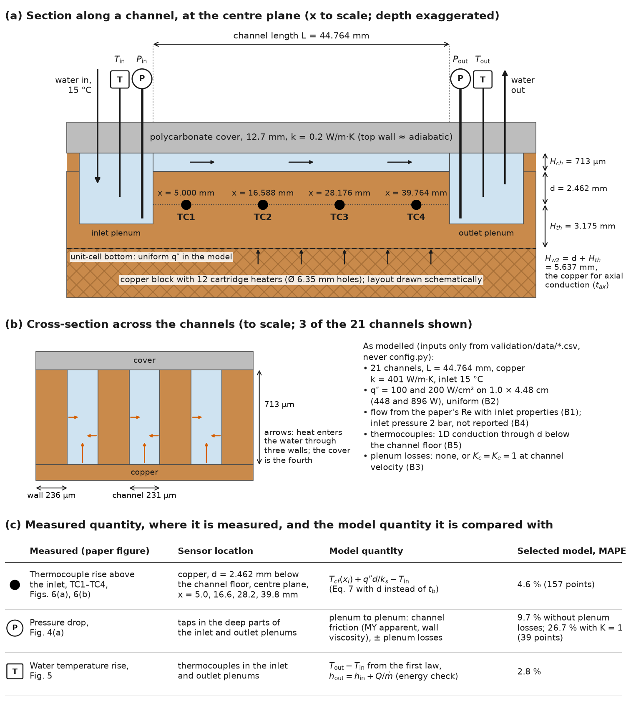

**Figure 8.** The Qu and Mudawar test section as modelled, and the model quantity compared with each sensor. (a) Section along a channel (x to scale, depth exaggerated): cover, plenums with the pressure and temperature sensors, and TC1–TC4 at 5.000, 16.588, 28.176 and 39.764 mm from the inlet, d = 2.462 mm below the channel floor. The heater layout and the plenum shape are not reported in the paper and are drawn schematically. (b) Cross-section to scale, with the inputs and the benchmark assumptions B1–B5. (c) Each measured quantity, its sensor location, the model quantity it is compared with, and the MAPE of the selected model (thermocouples 4.6 % on the 157-point matrix; 4.61 % on the 156 points after the recheck) (`figures/fig_F_benchmark_setup.png`).

### 7.2 Quantities taken from the paper

Table 10 lists every quantity we took from the paper. Status means: *measured* = a number stated in the paper's text or tables; *derived* = computed by us from stated values; *digitized* = read from a figure; *assumed* = our choice; *missing* = not reported. All text and table values were checked against the PDF in the recheck (section 7.6).

**Table 10.** Quantities taken from Qu and Mudawar (2002).

| Quantity | Value | Unit | Location in the paper | Status | Why the model needs it |
|---|---|---|---|---|---|
| Number of channels | 21 | – | Sec. 2.2 | measured | flow per channel, heat transfer area |
| Channel width W_ch | 231 | µm | Abstract; Sec. 2.2; Table 1 | measured | D_h, aspect ratio, velocity |
| Channel depth H_ch | 713 | µm | Abstract; Table 1 (Sec. 2.2 says 712) | measured | D_h, aspect ratio, fin height |
| Wall half-width W_w | 118 | µm | Table 1 | measured | fin thickness |
| Wall (fin) thickness | 236 | µm | = 2 × W_w | derived | fin efficiency |
| Channel length L | 44.764 | mm | Table 1 | measured | entry-length variable z*, friction length |
| Planform width × length | 1.0 × 4.48 | cm | Sec. 2.2; Eq. (1) | measured | heated area, heat flux |
| Planform area A_t | 4.48 | cm² | Sec. 2.3, Eq. (1) | measured | converts heat flux to power |
| Cover plate thickness H_w1 | 12 700 | µm | Table 1; Nomenclature | measured | not used in the model (top taken as adiabatic) |
| Unit-cell bottom to channel bottom H_w2 | 5637 | µm | Table 1; Nomenclature | measured | base thickness for axial conduction; thermocouple depth |
| Thermocouple plane height H_th | 3175 | µm | Table 1; Eq. (27) | measured | thermocouple depth |
| Thermocouple depth below channel bottom | 2.462 | mm | = H_w2 − H_th | derived | conduction between channel floor and thermocouple, Eq. (7) |
| Thermocouple positions TC1–TC4 from the inlet | 5.000, 16.588, 28.176, 39.764 | mm | Sec. 2.2; Table 1 (L1 = 5, L2 = L3 = L4 = 11.588 mm) | derived | where the model temperature is read |
| Solid | oxygen-free copper, k = 401 | W/m·K | Sec. 2.2; Sec. 3.3 | measured | fins and base conduction |
| Cover | polycarbonate, k = 0.2 | W/m·K | Sec. 2.2; Sec. 3.3 | measured | justifies three-sided heating |
| Heaters | 12 cartridge heaters in 6.35 mm holes below the channels | – | Sec. 2.2 | measured | heat enters from below |
| Fluid | deionized water | – | Abstract; Sec. 2.1 | measured | properties |
| Inlet temperature | 15 | °C | Sec. 2.3 | measured | inlet state |
| Effective heat flux q″_eff = P_W/A_t | 100 and 200 | W/cm² | Abstract; Sec. 2.3; Eq. (1) | measured | heat input |
| Heat input | 448 and 896 | W | = q″_eff × A_t | derived | Q in the model |
| Re range | 139–1672 (100 W/cm²), 385–1289 (200 W/cm²) | – | Abstract; Sec. 2.3 | measured | test range; check of the digitized Re |
| Re definition | based on inlet parameters | – | Eq. (2) | measured | converts Re to mass flow |
| Flow range | 93.5–1136.4 (100 W/cm²), 259.1–859.5 (200 W/cm²) | ml/min | Sec. 2.3 | measured | check of our Re-to-flow conversion |
| Maximum measured ΔP | 0.86 at Re = 1672, 100 W/cm² | bar | Sec. 3.2 | measured | check of the digitized ΔP axis |
| Heat loss | < 1 | % of input | Sec. 2.4 | measured | justifies Q = full electrical power |
| Uncertainties: wattmeter / rotameter / pressure / thermocouples | 0.5 % / 4 % / 3.5 % / 0.3 °C | – | Sec. 2.4 | measured | to judge the size of the model error |
| Thermocouple and water temperature locations | TCs in the copper below the channels on the centre plane; T_in, T_out in the plenums | – | Sec. 2.2 | measured | what to compare with |
| Pressure tap locations | deep portions of the inlet and outlet plenums | – | Sec. 2.2 | measured | measured ΔP includes plenum losses |
| Inlet condition of the paper's own model | uniform velocity | – | Eq. (11) | measured | supports the simultaneously developing model |
| Plenum loss coefficients | "close to unity", no values or plenum dimensions | – | Eqs. (18)–(22) | missing | minor losses; treated as a sensitivity |
| Outlet or system pressure | not reported | Pa | – | missing; 2 bar assumed | water properties (small effect) |
| ΔP against Re | 43 points | bar | Fig. 4(a) | digitized | pressure-drop validation |
| Water temperature rise against Re | 43 points | K | Fig. 5 | digitized | energy-balance check |
| Thermocouple rise above inlet against Re | 187 points | K | Fig. 6(a), 6(b) | digitized | thermal validation |

The Re-to-flow conversion with inlet-temperature properties reproduces the paper's stated flow rates: Re 139 gives 94.1 ml/min (paper 93.5) and Re 1672 gives 1132 ml/min (paper 1136.4).

### 7.3 Why Figs. 4(a), 5 and 6, and why at the thermocouple plane and plenum to plenum

The paper gives its measurements only as figures, so the data had to be read from them.

- **Fig. 4(a)**: measured pressure drop against Re for both heat fluxes. This is the pressure-drop validation.
- **Fig. 6(a), 6(b)**: the four thermocouple readings against Re at 100 and 200 W/cm². This is the thermal validation, and with four positions along the channel it also tests the shape of the temperature profile, which is where developing flow shows up.
- **Fig. 5**: water temperature rise against Re. The model gets this from the first law alone, so it does not test the heat transfer model. We use it as an energy-balance check of the data and of our Re-to-flow conversion.

We did not digitize Fig. 7 (temperature along the thermocouple line; optional) or Fig. 4(b) (the paper's own prediction).

We compare like with like:

- *Thermocouple plane.* The thermocouples sit in the copper 2.462 mm below the channel bottom, not at the channel wall and not at a "device". So the model temperature we compare is the channel-floor temperature at each thermocouple position plus one-dimensional conduction through 2.462 mm of copper. Comparing our device temperature or the channel-wall temperature directly with the thermocouples would not be a like-for-like comparison.
- *Plenum to plenum.* The pressure transducers are connected to the deep parts of the inlet and outlet plenums, so the measured ΔP is channel friction plus the contraction and expansion losses. The paper's own prediction adds these (its Eqs. 18–22). We therefore report the model both without plenum losses and with K_c = K_e = 1.

### 7.4 How a student would extract the data by hand

This is the manual route with the free WebPlotDigitizer browser app [14]. It is the method we would recommend to someone repeating the work, and it is the method for the pending hand check (section 7.6).

1. **Get a clean image.** Open the PDF, zoom to 200–400 % on the figure and take a screenshot of just that plot (PNG). Higher resolution means a smaller reading error.
2. **Load and calibrate.** *File → Load image*, choose *2D (X-Y) Plot*, then click four reference points: two on the x axis and two on the y axis, and type their values. Use tick marks far apart to reduce the error.
3. **Pick points.** In manual mode click the centre of each marker. Digitize the markers (measured data), not the lines (the paper's predictions). Make a separate dataset for each series (100 and 200 W/cm², or TC1–TC4).
4. **Check the calibration.** Digitize a point whose value is known, for example the 0.86 bar maximum ΔP at Re = 1672. If it is off by more than about 1–2 % of the axis range, recalibrate.
5. **Export.** *View data → Download .CSV* for each dataset, and save the WebPlotDigitizer project so the work can be redone.
6. **Copy into the data files**, one row per point, with the figure, heat flux, Re, the value as read and its unit, the value converted to SI, and status = digitized.
7. **Record the reading uncertainty**: about half a marker width, converted to axis units.

### 7.5 How we actually did it

The figures have many markers, and repeat runs put markers partly on top of each other, so we scripted the extraction (`validation/digitize/`). Figure 9 shows the steps.

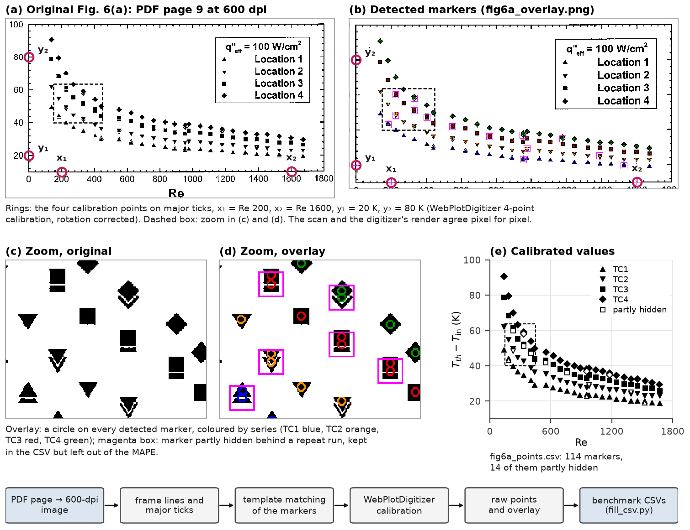

**Figure 9.** Data extraction, with Fig. 6(a) of the paper as the example: (a) original (PDF page 9 at 600 dpi) with the four calibration points ringed (Re 200 and 1600, 20 and 80 K); (b) detection overlay, a circle on every detected marker, coloured by series; (c, d) the same zoom in the original and the overlay, showing markers partly hidden behind repeat runs (magenta boxes); (e) the calibrated values (114 markers, 14 partly hidden). The strip at the bottom shows the pipeline: PDF page → 600-dpi image → frame lines and major ticks → template matching of the markers → WebPlotDigitizer calibration → raw points and overlay → benchmark CSVs (`figures/fig_G_data_extraction.png`).

1. **Rendering.** Each PDF page is rendered at 600 dpi. The figures in the PDF are 600-dpi scans, so this is their native resolution.
2. **Frame and tick detection.** The scans are slightly rotated. The four frame lines of each plot are fitted by least squares, and the major tick marks are detected on them. The values of the ticks were assigned by reading the axis labels in the figure.
3. **Marker detection.** The markers (squares, diamonds, up and down triangles) are found by template matching. Templates are built from clean, isolated markers of the same figure, so their size and line width match the scan. The best match is accepted, its pixels are marked as explained, and the search is repeated. A later match must explain enough new ink, which is how a marker partly hidden behind another one is still found. The legend is excluded. The position of a marker is its area centroid.
4. **Calibration with WebPlotDigitizer, headless.** The pixel positions are converted to data values by WebPlotDigitizer's own axis calibration [14] (4 points on major ticks, rotation corrected), run from its unmodified source code without the browser.
5. **Cross-check with WebPlotDigitizer's blob detector.** WebPlotDigitizer's own marker detection is run on the same image. For isolated markers the two methods must agree within 1.5 px.
6. **Outputs.** For each panel a raw CSV (pixel and data coordinates, shape, series, flags) and an overlay image with every detected marker circled, for the visual check. A second script copies the raw points into the benchmark CSVs with a status and a reading uncertainty.

*Partly hidden and rejected points.* A marker that is partly hidden behind another one at nearly the same Re (a repeat run) gets the status `digitized_partly_hidden`. Its position is less certain, so it is kept in the CSV but left out of the MAPE. One point was rejected after looking at the overlays: in Fig. 5 a square template matched on a partly hidden 200 W/cm² triangle at Re ≈ 445 and gave 40.7 K for the 100 W/cm² series, where the real 100 W/cm² point at that Re is 20.4 K. It is kept in the CSV with status `rejected` and the reason. Table 11 gives the counts.

**Table 11.** Digitized points (after the recheck).

| Figure | Quantity | Points found | Used in the MAPE | Partly hidden | Rejected | Reading uncertainty |
|---|---|---|---|---|---|---|
| Fig. 4(a) | ΔP | 43 | 39 | 4 | 0 | about ±0.0014 bar, ±1.2 in Re |
| Fig. 5 | water temperature rise | 43 | 38 | 4 | 1 | about ±0.11 K, ±1.3 in Re |
| Fig. 6(a) | thermocouple rise, 100 W/cm² | 114 | 100 | 14 | 0 | 0.125–0.5 K (Figs. 6(a) and 6(b)) |
| Fig. 6(b) | thermocouple rise, 200 W/cm² | 73 | 56 | 17 | 0 | |

The reading uncertainty is 1 px for the centroid, plus one sixth of the marker height for triangles, because we do not know whether the plotting program anchored a triangle at its area centroid or at the centre of its bounding box.

*Checks built into the extraction.* The major-tick spacing is linear to within 1.4 px. Isolated markers agree with WebPlotDigitizer's blob centroids to 1.5 px or better. The last ΔP point reads 0.859 bar at Re 1670 (text: 0.86 bar at Re 1672), and the Re ranges read 139–1670 and 386–1288 (text: 139–1672 and 385–1289). The pipeline itself is tested on a synthetic plot with known points, which it recovers within 0.3 % of the axis range. That test needs Node.js and was skipped on our Windows machine, so it has only been run on Linux.

### 7.6 The recheck

On 2026-11-13 the data were rechecked, as far as possible independently of the digitizing script (`validation/data/raw/recheck_log.md`). The recheck was done with an AI assistant (Claude) and separate code; it is not the hand check by a person, which is still pending. Table 12 gives the six checks.

**Table 12.** Recheck of the benchmark data.

| # | Check | Result |
|---|---|---|
| 1 | Each test run appears in Figs. 4(a), 5 and 6 at the same Re | Pass with two notes. 25 runs at 100 W/cm² and 14 at 200 W/cm² in every figure (one Fig. 5 point at 200 W/cm² is partly hidden, and Fig. 6(b) has one extra repeat marker for TC3); Re mismatch between figures ≤ 3.8 (1 px is about 1.2–1.3 in Re) |
| 2 | Values stated in the text | Pass. 0.859 bar at Re 1670 against 0.86 bar at Re 1672; Re ranges agree |
| 3 | Fig. 5 against the energy balance | Pass, no digitizing error. Measured minus energy balance: mean −0.8 % (MAPE 2.0 %) at 100 W/cm² and −4.1 % (MAPE 4.1 %) at 200 W/cm² |
| 4 | Thermocouple order and smoothness | Pass. TC1 < TC2 < TC3 < TC4 at every run; rms scatter about a smooth fit 1.8–2.3 % (100 W/cm²) and 0.6–1.0 % (200 W/cm²) |
| 5 | Geometry, conditions and sensor values against the PDF text and Table 1 | Pass. Table 1 column alignment and the 2.462 mm thermocouple depth confirmed; TC1 is the inlet-side sensor; system pressure not reported |
| 6 | Independent re-reading: different renderer, calibration fitted through all major ticks, 12 random points per figure | Pass. Agreement within ≤ 0.003 bar for ΔP and ≤ 0.4 K for the thermocouple rises; one status corrected |

Results of the recheck:

- **No data value changed.** One status changed: in Fig. 6(b) two TC3 squares sit at Re 787.6, the lower one partly behind the upper one (a repeat run). The lower one (70.02 K) was moved to `digitized_partly_hidden`, like every other repeat marker. This changes the thermocouple MAPE of the selected model from 4.60 % (157 points) to 4.61 % (156 points). The full model matrix (Tables 6 and 7) was not rerun and still uses 157 points.
- In check 6 two Fig. 5 points differed more (up to 0.83 K). That came from the check and not from the data: the paper's prediction line passes through the markers there and two squares touch, so the check's simple centroid included part of the line. Zoomed crops show the CSV positions on the marker centres.
- Two physical observations were left in the data. At 200 W/cm² the measured water temperature rise is 2.5–5.7 % below the energy balance at every point, which is within the 4 % flow-rate uncertainty plus heat loss; it means the model, which uses the full Q, slightly over-predicts the water rise at 200 W/cm². And the run at Re ≈ 442, 100 W/cm², reads about 5 % low on all four thermocouples and on the water rise, which points to the real conditions of that run and not to a misread marker.
- The recheck shares one assumption with the script: that a marker's value is its area centroid. For triangles the plotting anchor could be the bounding-box centre, about 3 px (0.4 K) higher in Fig. 6.

**Still to do:** a hand check by a person (Suneel): look through the four overlay images and spot-check 5–10 points per figure in the WebPlotDigitizer browser app, following section 7.4. Until that is done we call the data "digitized and rechecked", not "hand-verified".

### 7.7 Reference tables used to check the correlation coefficients

The correlations were typed in from papers, and the PDF text of some papers had lost minus signs. We did not guess the signs. Each correlation was checked numerically against tabulated values or exact limits, and the checks are in the test suite. Table 13 lists them.

**Table 13.** Checks of the correlation coefficients.

| Correlation | Checked against | Result |
|---|---|---|
| Three-wall fully developed Nu, Eq. (11) | limits: 8.235 for parallel plates and 3.556 for a square duct; signs compared with a second quotation of the same fit | reproduced |
| Lee and Garimella local Nu [9] | Wibulswas Nu_x table for aspect ratios 3 and 4 (Table 2 of Lee et al. [11]); value at the thermal entry length z*_th | within 6 % (mean 2.5–2.8 %); gives 1.06–1.09 Nu_fd at z*_th, where the paper defines 1.05 |
| Muzychka-Yovanovich Nu, Eq. (8) | circular-tube limits Nu = 4.364 and 3.657; Lévêque solution 1.302 x*^(−1/3); Wibulswas table for aspect ratio 3 | limits reproduced exactly; thermal part within 9 % of Wibulswas (fully developed limit about 7–9 % high for rectangles) |
| Muzychka-Yovanovich apparent friction, Eq. (14) | Shah and London tabulated f_app Re for aspect ratios 1, 0.5, 0.2 and x⁺ = 0.001–0.2 (Table 3 of Duan and Ma [12]) | within 4 % |
| Hagenbach friction | same table | within 4 % for x⁺ ≥ 0.05; +75 % at x⁺ = 0.005 |
| Re definition | flow rates stated in the paper (section 7.2) | within 0.7 % |

Not yet checked against the original source: the coefficients of the fully developed Shah and London fits (Eq. 10 and the fully developed fRe polynomial), for which we do not have the page and equation number in the original book [6], and the viscosity exponents of Eq. (12) (section 8.6). Some of the tables above are also quoted through secondary sources (Lee et al., Duan and Ma) and not read in the original.

## 8. Validation results

### 8.1 Results

Table 14 gives the errors of the selected model (`MY_3` Nusselt number, axial conduction, wall-viscosity correction, `MY` apparent friction) against the Qu and Mudawar data, next to the model of the proposal. No coefficient was tuned.

**Table 14.** Validation results (MAPE). Thermocouple errors are on the temperature rise above the inlet.

| Quantity | Points | Selected model | Proposal's fully developed model | Proposal's target |
|---|---|---|---|---|
| Thermocouple rise, all | 157 (156 after the recheck) | 4.6 % (4.61 %), bias +0.7 %, largest 13.7 % | 49.1 % | 10–15 % |
| TC1 (5 mm from the inlet) | | 6.5 % | 73.3 % | |
| TC2 | | 5.0 % | 54.1 % | |
| TC3 | | 4.2 % | 38.0 % | |
| TC4 (5 mm from the outlet) | | 2.8 % | 31.1 % | |
| Water temperature rise | | 2.8 % | 2.9 % | – |
| ΔP, no plenum losses | 39 | 9.7 %, bias +0.5 %, largest 21.6 % | 21.4 % | 10–15 % |
| ΔP, with K_c = K_e = 1 | 39 | 26.7 %, bias +26.7 % | 44.3 % | |

Both the thermal error (4.6 %) and the pressure-drop error without plenum losses (9.7 %) are inside the 10–15 % target of the proposal. The pressure-drop result comes with the caveat of section 8.6.

The error of the fully developed model is largest at TC1 near the inlet (73 %) and falls along the channel (31 % at TC4). That is the signature of the entry region: the fully developed h is too low everywhere, and most wrong where the boundary layer is thinnest. The selected model removes most of this pattern, although TC1 is still its worst thermocouple.

At the one condition the paper states in its text (100 W/cm², Re = 1672, measured 0.86 bar) the selected model gives a friction pressure drop of 72.75 kPa, about 15 % below the measurement.

### 8.2 Comparison plots

Figure 10 shows the data and the model against Re, and Figure 11 the parity plots.

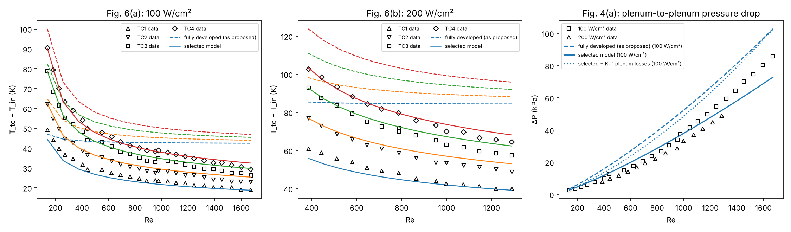

**Figure 10.** Qu and Mudawar data (open symbols) against the model. Left and middle: thermocouple rise above the inlet, TC1–TC4 (line colours blue, orange, green, red), at 100 and 200 W/cm²; solid lines are the selected model, dashed lines the fully developed model of the proposal (`fd_H1`, fully developed friction, no viscosity correction, plenum losses K_c = K_e = 1). Right: plenum-to-plenum pressure drop; solid line selected model without plenum losses, dotted line the same with K_c = K_e = 1, dashed line the fully developed model (model lines for 100 W/cm² only) (`figures/validation_vs_Re.png`).

In Figure 10 the fully developed model (dashed) is almost flat with Re at high flow, because its h does not depend on velocity, while the data keep falling. The selected model follows the data in level and slope for all four thermocouples. At 200 W/cm² it lies a little above TC2–TC4 and below TC1 at low Re. In the pressure-drop panel the data lie between the selected model without plenum losses and the same model with K = 1 at high Re.

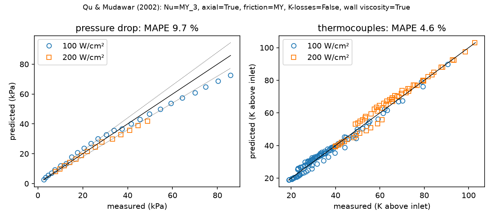

**Figure 11.** Parity plots for the selected model (`MY_3`, axial conduction, wall viscosity, `MY` friction, no plenum losses): pressure drop, 39 points (left; dotted lines ±10 %), and thermocouple temperature rise above the inlet in K, 156 points (right) (`figures/validation_parity.png`).

The right panel of Figure 11 gives a thermocouple MAPE of 4.6 % (4.61 % on the 156 points left after the recheck), the same as Table 14. An earlier version of this figure said 4.3 %. We traced the difference: one run of the comparison gives 4.61 % on the 156 thermocouple points, 2.84 % on the 38 water-temperature-rise points, and 4.26 % if the two sets are pooled into one mean. The old title used that pooled mean. The figure was regenerated with the thermocouple-only value, which is the one used everywhere in this report.

### 8.3 Model-by-model errors

Figure 12 shows the MAPE of every model combination (the numbers of Tables 6 and 7).

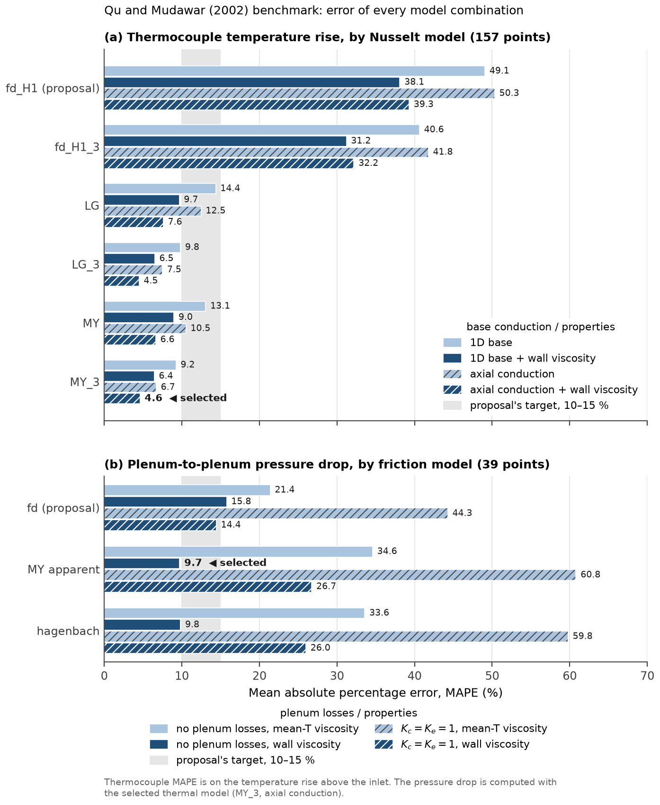

**Figure 12.** MAPE of every model combination on the Qu and Mudawar data. (a) Thermocouple temperature rise, by Nusselt model, 157 points (Table 6). (b) Plenum-to-plenum pressure drop, by friction model, 39 points (Table 7), computed with the selected thermal model (`MY_3` with axial conduction). Shaded band: the proposal's 10–15 % target (`figures/fig_H_model_mape.png`).

Reading the thermal results as a sequence of steps for the Muzychka-Yovanovich family (Table 6):

| Step | Thermocouple MAPE |
|---|---|
| Proposal: fully developed, four walls (`fd_H1`) | 49.1 % |
| Developing flow (`MY`) | 13.1 % |
| + three-sided heating (`MY_3`) | 9.2 % |
| + axial conduction | 6.7 % |
| + wall-viscosity correction (selected) | 4.6 % |

and for the pressure drop without plenum losses (Table 7): 21.4 % (fully developed, mean-temperature viscosity), 15.8 % (with the viscosity correction), 9.7 % (apparent friction with the viscosity correction). Developing flow is the main step in both. The other corrections are each a few points, and each has a physical reason that is independent of the data (section 6).

### 8.4 Effect of the digitizing uncertainty

Could the reading error of the figures change the conclusion? We shifted every thermocouple reading by its own reading uncertainty (0.125–0.5 K, from the `notes` column of the data file; the recheck found at most 0.4 K against an independent reading) and recomputed the MAPE of the selected model (`analysis/results/phase1_digitizing_uncertainty.csv`, 156 points).

**Table 15.** Thermocouple MAPE of the selected model under digitizing uncertainty.

| Case | MAPE | Bias |
|---|---|---|
| As digitized | 4.61 % | +0.64 % |
| All readings + uncertainty | 4.65 % | −0.23 % |
| All readings − uncertainty | 4.66 % | +1.53 % |
| Independent random shifts within ± uncertainty (2000 draws) | 4.63 % mean, 4.52–4.72 % (95 % range) | – |

The MAPE moves by about 0.1 percentage point at most. The digitizing uncertainty does not affect the validation conclusion; the model error (4.6 %) is much larger than the reading error. Only the temperature reading was shifted. The Re reading uncertainty (about ±1.3, under 1 % of Re) was not propagated.

For scale, the measurement uncertainties stated in the paper are 0.3 °C for the thermocouples, 4 % for the flow rate and 3.5 % for the pressure transducers.

### 8.5 How the validation transfers to our geometry

The benchmark heat sink is not our cold plate (Figure 2). What we validate is the physics model: the correlations for heat transfer and friction, the property handling and the conduction model. The correlations are written in dimensionless groups, so a model that reproduces an experiment over a range of Re, Pr, z* and heat flux can be used for another geometry inside that range. Table 16 compares the two cases.

**Table 16.** Dimensionless comparison of the design case and the benchmark.

| Quantity | Design case | Qu and Mudawar | Inside the validated range? |
|---|---|---|---|
| Re | 374 (2 L/min) – 917 (5.1 L/min optimum) | 139 – 1672 | yes |
| Thermal entry variable z* = L/(Re Pr D_h) at the outlet | 0.017 – 0.043 | 0.011 – 0.13 | yes |
| Heat flux at the base | 111 W/cm² | 100 and 200 W/cm² | yes |
| D_h | 375 µm | 349 µm | yes |
| Pr | about 5 | about 7 | close; the Muzychka-Yovanovich model is stated for 0.1 < Pr < ∞ |
| Heated walls | 3 | 3 | yes |
| Aspect ratio H/w_c | 15 | 3.1 | **no: extrapolation** |

The one gap is the aspect ratio. The design channels are much taller and narrower (H/w_c = 15 for the reference design, 30 at the 0.1 mm optimum) than the experiment's (3.1). We still use the model there, for these reasons:

- The Muzychka-Yovanovich model uses √A as the length scale in order to handle any aspect ratio, and it tends to the parallel-plate limit for tall channels.
- Our coefficient checks (Table 13) cover aspect ratios 1–4 for heat transfer and 0.2–1 (short side over long side) for friction, and the tall-channel limit is the textbook parallel-plate result.
- The design conclusions are the same with the fully developed model, which does not rely on the developing-flow correlations at all (Table 9).

Our statement of validity is therefore: the model is validated for laminar water flow in copper microchannels at Re 139–1672 and z* 0.011–0.13; the design case lies inside this range except for its aspect ratio, which is an extrapolation of the validation. The extra study with channels below 0.1 mm (H/w_c of 30–60) is further outside still. A stronger validation would need a second benchmark with tall channels (H/w_c ≥ 10); we list that as future work.

### 8.6 Limitations

1. **Plenum losses are not explained.** The best pressure-drop agreement (9.7 %) leaves out the contraction and expansion losses in the plenums, which must be positive. With the paper's "close to unity" coefficients the model over-predicts by 27 %. The paper's own 3D model also over-predicts its data in its Fig. 4(b), by roughly 5–30 % (our visual reading, not digitized). The paper gives no K values and no plenum dimensions, so we cannot do better from the paper. The residual also has a trend with Re: the model is above the data at mid Re and below at Re above about 1300. Possible causes, none confirmed: the K values and plenum geometry, the friction exponent 0.58 (derived for fully developed flow) applied in the entrance region, and the 4 % flow-rate uncertainty. For the 1 kW study this matters through the ΔP constraint and the pumping term. We cover it with a sensitivity: for K_c + K_e from 0 to 3 the minimum lost-work design keeps the same geometry, its flow changes within ±1.5 % and its lost work within ±0.3 %, and the pumping-power saving against the minimum thermal resistance design moves between 61 % and 66 % (`analysis/results/phase1_plenum_K.csv`).
2. **Viscosity exponents from a secondary source.** The exponents 0.14 and 0.58 of Eq. (12) are attributed to Kays and Crawford [13] but were taken as tabulated in the `ht` library. We have not checked the original table. The correction is essential for the pressure drop (34.6 % → 9.7 %), so this check matters; it is still open, and until it is done the exponents rest on a secondary source.
3. **Hand check pending.** The digitized points have been checked by the script's own cross-checks and by an independent recheck, but not yet by a person reading points by hand (section 7.6).
4. **Three-sided correction for `MY`.** Eq. (9) applied to the Muzychka-Yovanovich model is our extension, not a published result. `LG_3`, which is fully sourced, gives the same accuracy (4.5 %).
5. **Remaining thermal bias.** TC1 at 200 W/cm² is under-predicted by up to about 8 % at low Re. The likely cause is conduction and spreading in the real three-dimensional copper block near the inlet, which a one-dimensional base model cannot represent. We have not tested this.
6. **One benchmark.** The validation rests on one experiment, one geometry and an aspect ratio of 3.1 (section 8.5).
7. **Smaller open items.** The Re reading uncertainty was not propagated; the viscosity-correction loop uses a fixed 4 passes without a convergence test; the digitizer's own test has not been run on Windows (it needs Node.js); the coefficients of the fully developed Shah and London fits have not been checked in the original book.

## 9. Second-law analysis

This section applies the entropy balances of section 5.5 to the 1 kW case and explains where the lost work comes from. Unless stated otherwise, the numbers are for the reference geometry (w_c = w_f = 0.2 mm, 75 channels), Q = 1 kW, T_in = 30 °C and T0 = 25 °C, with the validated model and the pump inside CV-L (η_pump = 0.5, section 6.6). They come from `analysis/results/study1_flow_sweep.csv` and the Phase 1 CSVs named in the text.

### 9.1 Entropy balances for the three control volumes

All three control volumes are steady. For a steady control volume with heat Q̇_k crossing its boundary at temperature T_k (positive into the control volume) and one stream in and one out, the entropy balance is

$$0 = \sum_k \frac{\dot Q_k}{T_k} + \dot m\,(s_{in} - s_{out}) + \dot S_{gen} \tag{23}$$

Work carries no entropy. Applying Eq. (23) to each control volume gives Eqs. (17) to (19) of section 5.5.

*CV-P (package and TIM).* No fluid crosses this boundary. Q enters at the junction temperature T_j and leaves into the base at T_s, so Eq. (23) gives Eq. (17) directly. The temperature difference is fixed by our assumption R_TIM = 0.02 K/W: Q R_TIM = 20 K for every design. A hand estimate from Eq. (17) for the reference design: the hottest base point is T_dev − Q R_TIM = 69.0 − 20 = 49.0 °C, and the mean base temperature is somewhat lower. For T̄_s between 40 and 49 °C, T0 Ṡ_gen,P is 54 to 57 W. One evaluation of the model at the reference design gives 55.2 W (with T̄_s = 45.7 °C); CV-P is not written to the study CSVs. So the TIM destroys more exergy than the whole of CV-L at the reference design (48.7 W). We still keep it out of the objective, for two reasons:

- The cold plate designer cannot change it. With Q R_TIM fixed, it changes only through T̄_s.
- By Eq. (17), the same 20 K at a higher temperature generates less entropy. Adding CV-P to the objective would therefore slightly reward a hotter base, which is the opposite of what a cold plate should do.

CV-P is the package designer's problem. Its effect on the cold plate is through the device temperature limit (sections 10.3 and 10.4), not through the lost work.

*CV-C (the cold plate).* Water enters at (T_in, P_in) and leaves at (T_out, P_out), and heat enters through the base at the local temperature T_b. Eq. (23) gives Eq. (18). The code evaluates both terms exactly: s comes from CoolProp at (T, P), and the boundary term is the integral of q″/T_b along the channel. To see what Eq. (18) contains, use the Gibbs relation T ds = dh − v dP along the stream. With ṁ(h_out − h_in) = Q and a pressure drop ΔP, to first order

$$\dot S_{gen,C} \approx \underbrace{Q\left(\frac{1}{\bar T_f} - \frac{1}{\bar T_s}\right)}_{\text{heat transfer, base to water}} + \underbrace{\frac{\dot V\,\Delta P}{\bar T_f}}_{\text{friction}} \tag{24}$$

So CV-C contains only two irreversibilities: heat falling from the base to the water, and viscous friction, which dissipates the hydraulic power Ẇ_hyd at about the water temperature. It has no term for the warming of the coolant above T_in. For the reference design the two terms of Eq. (24) add up to within 0.5 % of the exact Ṡ_gen,C of Eq. (18), and replacing the exact boundary integral by Q/T̄_s changes Ṡ_gen,C by 0.15 % (assumption A1, Table 4).

*CV-L (cold plate plus the return to T_in).* CV-L contains the cold plate, the pump and an idealized cooler that brings the water back to T_in and rejects heat to a reservoir at T_in. The water returns to its inlet state, so the flow terms of Eq. (23) cancel. Heat Q enters at the base, the pump adds work Ẇ_pump, and by the energy balance Q + Ẇ_pump leaves at T_in. Eq. (23) becomes 0 = Q/T̄_s − (Q + Ẇ_pump)/T_in + Ṡ_gen,L, which is Eq. (19). Here T̄_s is the effective temperature at which the heat enters, defined by Q/T̄_s = ∫ q″/T_b dA, so CV-L uses the same exact boundary term as CV-C. Multiplying by T0 and rearranging gives the same result as an exergy balance:

$$X_{lost} = \dot W_{pump} + Q\left(1 - \frac{T_0}{\bar T_s}\right) - (Q + \dot W_{pump})\left(1 - \frac{T_0}{T_{in}}\right) \tag{25}$$

The lost work is the exergy put in (the pump work, and the heat Q at T̄_s) minus the exergy that leaves with the heat rejected at T_in. Because T_in = 30 °C is above T0 = 25 °C, the rejected heat still carries Q(1 − T0/T_in) = 16.5 W of exergy. CV-L does not count this as lost: what happens to it is decided outside the cold plate loop (chiller, dry cooler or heat reuse).

*How CV-C and CV-L are related.* The exergy balance of CV-C, with the flow exergy of Eq. (22) and X_out = ṁ(ψ_out − ψ_in), is X_out = Q(1 − T0/T̄_s) − T0 Ṡ_gen,C. Combining it with Eq. (25) gives an exact link between the two control volumes:

$$X_{lost,L} = T_0\,\dot S_{gen,C} + \left[X_{out} - Q\left(1 - \frac{T_0}{T_{in}}\right)\right] + \frac{T_0}{T_{in}}\,\dot W_{pump} \tag{26}$$

The first term is what the cold plate itself destroys. The bracket is what the cooler destroys when it brings the outlet water back to T_in: the water arrives carrying X_out, and only Q(1 − T0/T_in) leaves with the rejected heat. The last term is the pump term X_pump. Eq. (26) closes to within 10⁻⁷ W at all 27 points of the Study 1 sweep (0.5 to 12 L/min, including the two infeasible ones). At 2 L/min, for example, 36.97 + (27.84 − 16.49) + 0.35 = 48.66 W, which is the X_lost of the model. Eq. (26) shows where the coolant-warming loss sits in CV-C: it leaves the cold plate as exergy of the warm outlet water and is destroyed later, in the cooler. Section 9.4 builds on this.

### 9.2 The three loss terms of CV-L and how they scale with flow

Eq. (20) splits CV-L at the mean water temperature T̄_f into coolant warming, base-to-coolant heat transfer (the "gap" term) and pumping. Table 17 gives the three terms over the Study 1 sweep, together with the CV-C value and the outlet exergy, and Figure 13 plots them.

**Table 17.** Lost-work terms of CV-L against flow, reference geometry (`analysis/results/study1_flow_sweep.csv`). The optimum (5.13 L/min, X_lost 43.05 W) lies between the 5.0 and 5.5 L/min rows.

| V̇ (L/min) | Re | X_warm (W) | X_gap (W) | X_pump (W) | X_lost (W) | T0 Ṡ_gen,C (W) | X_out (W) | T_dev (°C) | Ẇ_hyd (W) |
|---|---|---|---|---|---|---|---|---|---|
| 0.5 | 115 | 46.68 | 34.12 | 0.02 | 80.82 | 36.80 | 60.49 | 88.88 | 0.008 |
| 1.0 | 201 | 23.43 | 36.08 | 0.08 | 59.59 | 36.87 | 39.13 | 75.61 | 0.039 |
| 2.0 | 374 | 11.75 | 36.57 | 0.35 | 48.66 | 36.97 | 27.84 | 69.02 | 0.178 |
| 3.0 | 547 | 7.84 | 36.37 | 0.85 | 45.06 | 36.91 | 23.79 | 66.79 | 0.433 |
| 5.0 | 894 | 4.71 | 35.67 | 2.67 | 43.06 | 37.06 | 19.82 | 64.94 | 1.360 |
| 8.0 | 1415 | 2.96 | 34.60 | 7.93 | 45.49 | 38.59 | 15.46 | 63.76 | 4.032 |
| 10.0 | 1762 | 2.37 | 33.97 | 13.48 | 49.81 | 40.71 | 12.12 | 63.29 | 6.851 |

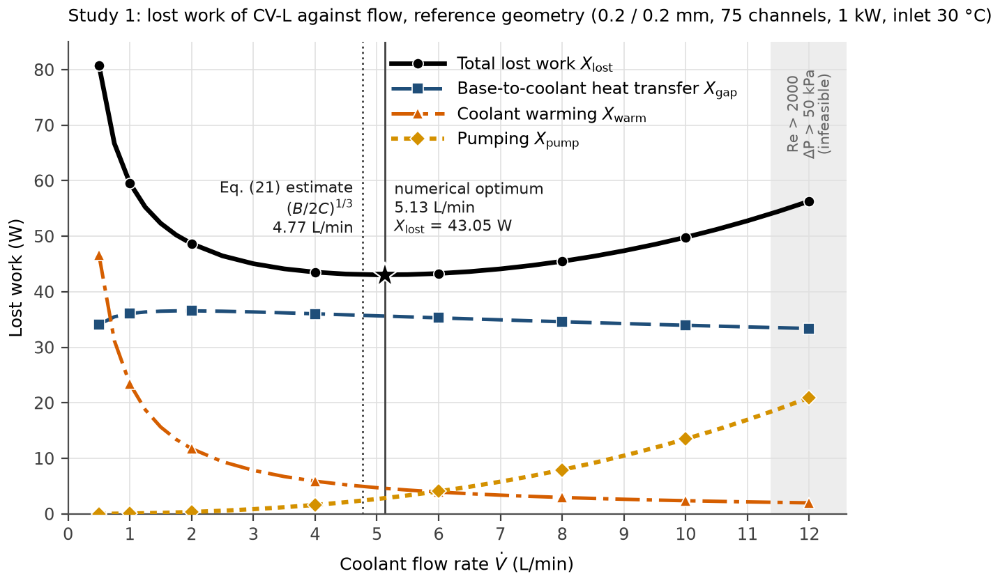

**Figure 13.** Study 1: lost work of CV-L and its three terms against flow for the reference geometry (0.2 / 0.2 mm, 75 channels, 1 kW, 30 °C inlet), with the numerical optimum (star and solid line, 5.13 L/min, 43.05 W) and the estimate of Eq. (21) (dotted line, 4.77 L/min). Shaded: infeasible flows. The edge is where Re reaches 2000, at about 11.4 L/min, found by linear interpolation between the 11.0 L/min (feasible) and 11.5 L/min (infeasible) sweep points; ΔP passes 50 kPa just above it, at about 11.5 L/min (`figures/fig_J1_flow_sweep.png`).

The three terms can be written as

$$X_{warm} \approx \frac{B}{\dot V}, \qquad X_{gap} = T_0\,Q\,\frac{\bar T_s - \bar T_f}{\bar T_f\,\bar T_s}, \qquad X_{pump} = \frac{T_0}{T_{in}}\,\frac{\dot V\,\Delta P}{\eta_{pump}} \approx C\,\dot V^{2} \tag{27}$$

*Coolant warming.* With a uniform heat flux the water warms linearly along the channel, so T̄_f ≈ T_in + Q/(2ṁc_p). Then 1/T_in − 1/T̄_f ≈ Q/(2ṁ c_p T_in²), which gives the first part of Eq. (27) with B from Eq. (21). Physically, this is the loss of letting the heat sit in water that is warmer than T_in before the cooler rejects it at T_in. Halving the flow doubles the water temperature rise and doubles the loss. For our case B = 23.4 W·(L/min), and B/V̇ is within 1.5 % of the model's X_warm from 0.5 to 10 L/min. Near the optimum, X_warm falls with flow with a local exponent of −0.99. This term is what creates an interior optimum: it is large at low flow (46.7 W at 0.5 L/min) and small at high flow (2.4 W at 10 L/min).

*Base-to-coolant heat transfer.* Heat falls from the base to the water across T̄_s − T̄_f, which is set by the convection and base-conduction resistances (the TIM is in CV-P, not here). This is the largest term at every flow: 75 % of the lost work at 2 L/min and 83 % at the optimum. Flow changes it in two opposite ways:

- (a) The water and the base get colder as the flow rises, and the same temperature difference at a lower absolute temperature generates more entropy (the product T̄_f T̄_s in Eq. 27). With fully developed flow, h does not depend on velocity, so this is the only effect and the term rises slowly with flow.
- (b) With developing flow, h rises with velocity, so T̄_s − T̄_f shrinks. The length-mean Nusselt number of the validated model rises from 9.16 at 2 L/min to 10.45 at 5 L/min and 12.27 at 10 L/min (the `Nu_mean` column of the Study 1 CSV).

In the validated model the net effect is a rise below about 2 L/min (34.1 W at 0.5 L/min to 36.6 W at 2 L/min) and a fall above it (34.0 W at 10 L/min). Either way the term changes by only a few watts over a 20-fold change in flow. More flow cannot remove the main irreversibility; only the geometry can (section 10.2).

*Pumping.* X_pump is the pump's electricity, Ẇ_elec = V̇ΔP/η_pump, weighted by T0/T_in. In fully developed laminar flow, ΔP ∝ V̇ (Eq. 13 with a constant fRe), so X_pump ∝ V̇². Two things make it grow a little faster in our model: the plenum losses, ΔP_m ∝ V̇², and the apparent friction of developing flow, whose entrance part grows with Re (Eq. 14). Near the optimum the local exponent of ΔP is 1.28 and that of X_pump is 2.28. The pumping term is negligible at the reference flow (0.35 W at 2 L/min, under 1 % of the lost work) and reaches 13.5 W at 10 L/min.

The pumping term of CV-L counts the electricity at T_in, while the friction term of CV-C (Eq. 24) counts only the hydraulic power at T̄_f. The difference is the loss inside the pump (half of the electricity at η_pump = 0.5), which CV-L includes because we put the pump inside it (section 6.6).

Even at the optimum, heat transfer (warming plus gap) makes up 93 % of the lost work and pumping only 7 %. The optimum is not where the losses are equal. It is where their slopes balance, as the next section shows.

### 9.3 The analytical optimum and why the numerical optimum differs

If X_gap is constant and X_pump = C V̇², then dX_lost/dV̇ = −B/V̇² + 2CV̇ = 0 gives Eq. (21), V̇* = (B/2C)^(1/3), and at V̇* the warming loss is X_warm = B/V̇* = 2CV̇*² = 2 X_pump. In the code, C is taken as X_pump/V̇² at the numerical optimum (`optimize.optimum_flow`), so Eq. (21) is a consistency check and not an independent prediction. For the reference geometry C = 0.108 W/(L/min)², and Eq. (21) gives 4.77 L/min. The numerical minimum of the full model is at 5.13 L/min (7.6 % higher), with X_lost = 43.05 W, and there the ratio X_warm/X_pump is 1.62 instead of 2 (`phase1_pump_cv.csv`).

To see why, write the optimum condition without the two simplifications. If locally X_warm ∝ V̇^(−n_w) and X_pump ∝ V̇^(n_p), setting dX_lost/dV̇ = 0 gives

$$\frac{X_{warm}}{X_{pump}} = \frac{1}{n_w}\left[\,n_p + \frac{\dot V}{X_{pump}}\,\frac{dX_{gap}}{d\dot V}\right] \tag{28}$$

which reduces to 2 for n_w = 1, n_p = 2 and a constant gap term. From the Study 1 sweep between 5.0 and 5.5 L/min we get n_w = 0.99, n_p = 2.28 and dX_gap/dV̇ = −0.37 W per L/min. Eq. (28) then gives (2.28 − 0.67)/0.99 = 1.62, which is the model's value. The two simplifications of Eq. (21) therefore pull in opposite directions:

1. **The gap term falls with flow** (effect (b) of section 9.2). This is a benefit of extra flow that Eq. (21) does not see. It lowers the ratio by 0.67 and moves the optimum to higher flow. At 5.13 L/min, one more L/min lowers the warming loss by about 0.9 W and the gap loss by about 0.4 W, and raises the pumping loss by about 1.3 W. So the gap term supplies about 30 % of the benefit of extra flow.
2. **Pumping grows faster than V̇²** (plenum losses and entrance friction). This makes flow more expensive. It raises the ratio by 0.28 and moves the optimum to lower flow.

The first effect is larger, so the numerical optimum lies above Eq. (21).

The fully developed model confirms this explanation from the other side (`phase1_fd_vs_validated.csv`). There h does not rise with velocity, and the gap term increases slightly with flow, from 40.35 W at 2 L/min to 41.00 W at 4.53 L/min (effect (a) alone). The sign of the gap slope flips, the ratio becomes 2.43, and the numerical optimum (4.53 L/min) lies below that model's own Eq. (21) value (4.84 L/min).

So the proposal's check "warming ≈ 2 × pumping at the optimum" holds exactly only for a constant h and pure V̇² pumping. Both models depart from it in the direction their physics predicts, and Eq. (21) stays within 8 % of the numerical optimum in both. The error matters little in practice because the minimum is flat: at 4.5 L/min the lost work is only 0.14 W (0.3 %) above the minimum. The proposal's first estimate of 4 to 5 L/min was made with the fully developed model; with the validated model the optimum is just above that range.

### 9.4 Why CV-C alone gives no useful optimum

The T0 Ṡ_gen,C column of Table 17 is almost flat. Between 0.5 and 4.5 L/min it stays between 36.78 and 36.97 W (a spread of 0.5 %), with its lowest value at 0.75 L/min. Above that it rises as friction grows, to 38.59 W at 8 L/min and 43.86 W at 12 L/min. The small wiggles below 4.5 L/min are far smaller than the effect of any uncertain input, so for design purposes CV-C is indifferent to flow up to about 4.5 L/min and penalizes flow above it. A designer using CV-C would have no reason to choose any flow between 0.5 and 4.5 L/min. In practice the choice would fall to the device limit (88.9 °C at 0.5 L/min), so it would be set by a constraint and not by thermodynamics.

Eq. (24) explains why: CV-C contains the gap term and friction, but no coolant-warming term. With fully developed flow (the proposal's model) the gap term rises slightly with flow and so does friction, so Ṡ_gen,C only rises and has no interior optimum at all, as the proposal expected. With developing flow, the fall of the gap term roughly cancels the rise of friction up to about 4.5 L/min, which gives the flat region.

Where did the warming loss go? By Eq. (26), it leaves with the water as X_out: 60.5 W at 0.5 L/min, 27.8 W at 2 L/min and 12.1 W at 10 L/min (Table 17). Low flow makes hot outlet water, and CV-C counts that hot water as a product. That would be correct if the heat were used at the outlet temperature (heat reuse, section 10.3). In a data-center loop it is not: the coolant distribution unit cools the water back to T_in, and the exergy is destroyed there. CV-L charges that destruction to the flow choice that caused it, which is why CV-L has an optimum and CV-C does not. The difference comes from where we draw the boundary, not from the physics inside the cold plate.

CV-C is still useful for comparing geometries, because the gap term, which the geometry controls, appears in both control volumes. In Study 2 (Table 18), Ṡ_gen,C is 0.0815 W/K for the minimum lost-work design, 0.0959 W/K for the minimum thermal resistance design, 0.124 W/K for the reference design and 0.185 W/K for the minimum hydraulic power design. That is the same ranking as CV-L gives. What CV-C cannot do is choose the flow.

### 9.5 Second-law checks

The validation section of the proposal asked for two second-law checks: entropy generation positive everywhere, and warming about twice pumping at the optimum. Together with the other checks we made:

- **Ṡ_gen > 0.** Every CV-C and CV-L value in the study CSVs is positive, and CV-P is positive by construction (T_j > T_s). The test suite checks Ṡ_gen > 0 over a flow sweep.
- **Warming ≈ 2 × pumping at the optimum.** 1.62 with the validated model and 2.43 with the fully developed model. Both deviations are explained by Eq. (28) (section 9.3).
- **Closure.** The three CV-L terms sum to the closed form of Eq. (19) (test), and the link between CV-C and CV-L, Eq. (26), closes at all 27 sweep points.
- **Boundary temperature.** For the reference design the exact CV-C boundary term ∫q″/T_b dA and the mean-temperature form Q/T̄_s differ by 0.006 %. Because Ṡ_gen,C is a small difference of two large terms, it changes by 0.15 % when the mean form is used (A1); the test allows 1 %.
- **Dead state.** The flow exergy is zero at the dead state (test). Lost work is proportional to T0 and the optimum flow does not depend on it: Study 4 gives 40.89 W at T0 = 10 °C and 44.50 W at 35 °C, which is 43.05 W × T0/298.15 K, at the same 5.13 L/min (section 10.4).

## 10. Design studies and results

This section gives the four studies of the proposal and the extra checks of Phase 1. Unless stated otherwise every run uses the 1 kW case of Table 2: T_in = 30 °C, T0 = 25 °C, the validated model, the pump inside CV-L with η_pump = 0.5, K_c + K_e = 1.5, and the limits T_dev ≤ 90 °C, ΔP ≤ 50 kPa, Re ≤ 2000, 0.1 ≤ w_c ≤ 1.0 mm and 0.1 ≤ w_f ≤ 0.5 mm. For each study we give the result, the physics behind it and what it means for someone designing a cold plate.

| Study | What is varied | Results file |
|---|---|---|
| 1 | flow, reference geometry | `analysis/results/study1_flow_sweep.csv` |
| 2 | w_c, w_f and flow, three objectives | `analysis/results/study2_designs.csv` |
| 3 | inlet temperature 20–60 °C, reference geometry | `analysis/results/study3_inlet_temperature.csv` |
| 4 | R_TIM, η_pump, T0, plenum K | `analysis/results/study4_sensitivity.csv` |
| Phase 1 | channels below 0.1 mm; pump inside or outside CV-L; plenum K on the design optimum; fully developed model; flow capped at 2 L/min | `study5_below_limit.csv`, `phase1_pump_cv.csv`, `phase1_plenum_K.csv`, `phase1_fd_vs_validated.csv`, `phase1_flow_cap.csv` |

### 10.1 Study 1: flow sweep at the reference geometry

We swept the flow from 0.5 to 12 L/min at the reference geometry (Table 17, Figure 13).

**Result.** The lost work has a clear minimum at 5.13 L/min: X_lost = 43.05 W, T_dev = 64.87 °C, ΔP = 16.86 kPa, Ẇ_hyd = 1.44 W and Re = 917. The reference flow of 2 L/min gives 48.66 W, so it wastes 13 % more than the optimum. Every flow from 0.5 to 11 L/min is feasible. At 11.5 L/min both the Re limit (2022) and the ΔP limit (50.06 kPa) are exceeded.

The minimum is flat. Within 5 % of the minimum lost work (up to 45.2 W) the flow can be anywhere from 3 to 7.5 L/min. Over that range, however, the hydraulic power grows eight-fold (0.43 to 3.46 W) while T_dev falls by only 2.9 K (66.79 to 63.90 °C). Above the optimum, doubling the flow from 5 to 10 L/min lowers T_dev by 1.65 K and multiplies the hydraulic power by 5.0 (1.36 to 6.85 W).

**Physics.** The device temperature is T_dev = T_out + (the drops across convection, base and TIM). Flow only acts on the first part, the coolant temperature rise T_out − T_in, which is already down to 2.9 K at 5 L/min. The rest, T_dev − T_out, stays at about 30 to 32 K over the whole sweep. 20 K of that is the TIM, and most of the remainder is convection at an h that flow raises only slowly (section 9.2). This is the "more flow cannot fix a bad geometry" point of the proposal, in numbers. On the lost-work side, the warming loss falls as 1/V̇ and the pumping loss rises as about V̇^2.3 (section 9.2), and the minimum sits where their slopes balance, corrected for the slowly falling gap term (section 9.3).

**For a designer.** At this geometry, about 5 L/min is the thermodynamically worthwhile flow for 1 kW. Below about 3 L/min the coolant warming loss grows quickly. Above about 7.5 L/min the extra flow costs more pump work than it saves in heat-transfer loss, and buys almost no device temperature. A designer who minimizes thermal resistance would push this geometry to the Re or ΔP limit (11 L/min, T_dev 63.10 °C) and spend six times the hydraulic power of the optimum (8.62 against 1.44 W) to gain 1.8 K.

### 10.2 Study 2: minimum lost work against minimum thermal resistance

Study 2 optimizes w_c, w_f and the flow together (grid sweep, SLSQP and the whole-channel polish of section 6.7) for three objectives under the same constraints: minimum lost work (ours), minimum thermal resistance (the comparison design of the proposal) and minimum hydraulic power (an extra reference). Table 18 gives the designs and Figure 14 compares them.

**Table 18.** Study 2 designs (`analysis/results/study2_designs.csv`). Pump inside CV-L, η_pump = 0.5, K_c + K_e = 1.5.

| | Reference | Min lost work | Min R_th | Min hydraulic power |
|---|---|---|---|---|
| w_c / w_f (mm) | 0.200 / 0.200 | 0.100 / 0.100 | 0.110 / 0.100 | 0.311 / 0.100 |
| Channels N | 75 | 150 | 142 | 72 |
| Flow (L/min) | 2.00 | 3.17 | 5.66 | 0.64 |
| Re | 374 | 298 | 548 | 140 |
| ΔP (kPa) | 5.3 | 32.9 | 50.0 | 0.38 |
| T_dev (°C) | 69.02 | 61.57 | 60.17 | 89.91 |
| R_th (K/W) | 0.0390 | 0.0316 | 0.0302 | 0.0599 |
| Ẇ_hyd [Ẇ_elec] (W) | 0.18 [0.36] | 1.74 [3.48] | 4.72 [9.43] | 0.004 [0.008] |
| X_warm / X_gap / X_pump (W) | 11.75 / 36.57 / 0.35 | 7.40 / 22.52 / 3.42 | 4.16 / 23.94 / 9.27 | 36.06 / 53.73 / 0.01 |
| X_lost (W) | 48.66 | 33.34 | 37.38 | 89.80 |
| Ṡ_gen,C (W/K) | 0.124 | 0.0815 | 0.0959 | 0.185 |
| X_out (W) | 27.84 | 22.11 | 16.01 | 51.19 |
| Limits reached | none | w_c and w_f at the 0.1 mm bound | ΔP = 50 kPa; w_f at the bound | T_dev ≈ 90 °C; w_f at the bound |

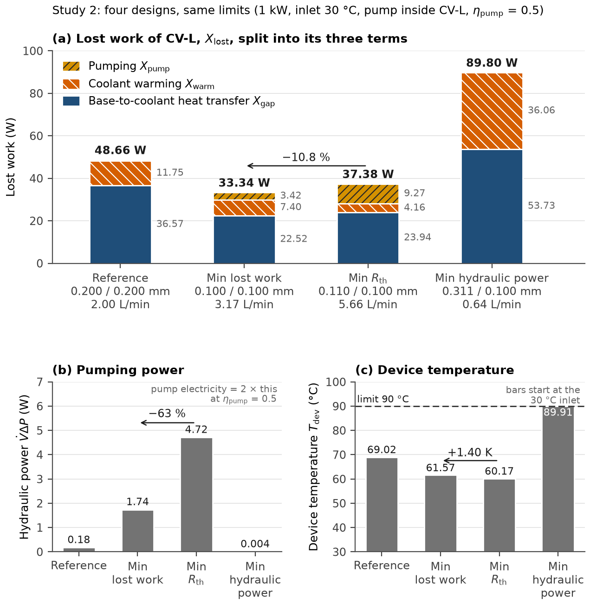

**Figure 14.** Study 2: (a) lost work split into its three terms, (b) hydraulic power V̇ΔP (the pump electricity is twice this at η_pump = 0.5) and (c) device temperature with the 90 °C limit, for the reference, minimum lost-work, minimum thermal resistance and minimum hydraulic power designs. The arrows mark the differences between the minimum lost-work and minimum R_th designs (−10.8 % lost work, −63 % hydraulic power, +1.40 K). The T_dev bars start at the 30 °C inlet (`figures/fig_J2_designs.png`).

**Result.** Against the minimum thermal resistance design, the lost-work design uses 44 % less flow (3.17 against 5.66 L/min) and **63 % less pumping power** (1.74 against 4.72 W hydraulic; 3.48 against 9.43 W of pump electricity at η_pump = 0.5). It has **10.8 % less lost work** (33.34 against 37.38 W), and its device runs **1.40 K hotter** (61.57 against 60.17 °C), which is a 4.6 % higher thermal resistance. The saving depends on two of our choices, the pump inside CV-L and η_pump = 0.5 (section 6.6). With the pump outside the control volume it is 41 % (section 10.5.2).

**Physics.** The two designs almost agree on the geometry and differ in the flow:

- *Geometry.* Both use the thinnest allowed fins (0.1 mm), which leaves room for more channels and more wetted area, and channels at or near the narrowest allowed width. A narrower channel has a smaller D_h, so a higher h = Nu k/D_h, and there are more channels across the 30 mm plate. This attacks the gap term, the largest loss. Going from the reference geometry at its own optimum flow (5.13 L/min, 43.05 W) to the 0.1 mm design cuts the lost work by 22.5 %, almost all of it in the gap term (35.62 to 22.52 W). Optimizing the flow at the reference geometry gave only 11.5 % (48.66 to 43.05 W). For this case, geometry is worth about twice as much as flow.
- *Flow.* The minimum R_th design has no reason to stop adding flow. More flow always lowers T_out and raises h, so it keeps going until the ΔP limit stops it at 50 kPa. It sits on the constraint, with the channel slightly wider than the bound (0.110 mm), where the higher h of a narrower channel balances the extra flow a wider channel allows within the 50 kPa budget. The lost-work design stops at 3.17 L/min with ΔP = 32.9 kPa, well below the limit. Its flow is an interior optimum set by thermodynamics, not by a constraint.
- *Where the 4.0 W of lost work is saved.* Going from the minimum R_th design to the lost-work design, the pumping term falls by 5.85 W (9.27 to 3.42 W), the warming term rises by 3.24 W (4.16 to 7.40 W) because the water is warmer, and the gap term falls by 1.42 W (23.94 to 22.52 W) because the channels are narrower.

The minimum hydraulic power design shows the other extreme. It barely pumps (0.004 W) but runs the device at the 90 °C limit and loses 89.80 W, 2.7 times the lost-work design, almost all in heat transfer. Each of the two single-loss criteria (thermal resistance, pumping power) ignores one of the two competing losses and ends up on a constraint. Lost work weighs both and gives a design in between.

**For a designer.** The minimum thermal resistance design buys 1.4 K of device temperature for 2.7 times the pump power. At 61.6 °C the lost-work design still has 28.4 K of margin to the 90 °C limit, so the extra 1.4 K is rarely worth it. A second point matters as much: a design that sits on a constraint inherits every uncertainty in that constraint. If the 50 kPa budget were raised, the minimum R_th design would take more flow and more pump power. The lost-work design would not change, because its ΔP limit is not active. Section 10.5 shows the same thing for the uncertain plenum losses.

**Why more flow than current practice?** The lost-work design uses 3.17 L/min for 1 kW, about 3.2 L/min per kW. That is above the 1 to 2 L/min per kW that our proposal quotes as typical industry practice. We see two reasons, and both come from what the model is asked to do, not from an error in it:

1. *The objective counts the warming of the coolant as lost work.* In CV-L the warm outlet water is assumed to be cooled back to T_in, so its exergy is destroyed in the cooler (Eq. 26, section 9.4). That loss, X_warm ≈ B/V̇, is what pushes the optimum toward higher flow. If the heat were reused instead (building or district heating, for example), the exergy of the outlet water would be a product, not a loss. The warming term would shrink and the optimum would move to lower flow. We have not run this case; it follows from Eq. (26), not from a model run.
2. *Rack-level limits are not modelled.* We optimize one cold plate with a 50 kPa budget. In a rack, dozens of cold plates share one pump and one coolant distribution unit, whose flow, head and cost limit the flow per cold plate. None of this is in our objective or constraints.

So 3.2 L/min per kW is the thermodynamic optimum for one cold plate whose heat is rejected at T_in, not a flow recommendation for a rack. Two numbers put it in context. Against the minimum thermal resistance design (5.66 L/min), our design already uses 44 % less flow. And capping the flow at 2 L/min, the top of current practice, costs only 6.1 % more lost work with the same geometry (section 10.5.5).

### 10.3 Study 3: inlet temperature from 20 to 60 °C

At the reference geometry we found the lost-work optimum flow, subject to the device, ΔP and Re limits, for inlet temperatures from 20 to 60 °C in steps of 2.5 K. The proposal's range is 20 to 50 °C; we extended it to 60 °C to find where the device limit takes over. The CSV also gives a "floor" temperature, T_in + Q(R_conv + R_base + R_TIM). This is the device temperature without the coolant temperature rise, evaluated at the flow found. Table 19 and Figure 15 give the results.

**Table 19.** Study 3, reference geometry (`analysis/results/study3_inlet_temperature.csv`; selected rows). The 30 °C row is the baseline of Study 1 from a separate optimizer run: it gives 5.137 L/min, Re 918 and 64.86 °C, where Study 1 and Table 20 give 5.132 L/min, Re 917 and 64.87 °C. The two runs differ by 0.1 % in flow, well inside the flat minimum (the lost work is 43.05 W in both). Elsewhere in the report we quote the Study 1 value, 5.13 L/min.

| T_in (°C) | V̇* (L/min) | Re | ΔP (kPa) | T_dev (°C) | X_lost (W) | X_out (W) | Status |
|---|---|---|---|---|---|---|---|
| 20 | 4.93 | 706 | 18.8 | 55.10 | 46.71 | −13.58 | entropy optimum |
| 25 | 5.04 | 809 | 17.8 | 59.98 | 44.82 | 3.29 | entropy optimum |
| 30 | 5.14 | 918 | 16.9 | 64.86 | 43.05 | 19.61 | entropy optimum |
| 35 | 5.20 | 1027 | 16.0 | 69.78 | 41.41 | 35.45 | entropy optimum |
| 40 | 5.30 | 1149 | 15.4 | 74.68 | 39.87 | 50.74 | entropy optimum |
| 45 | 5.37 | 1270 | 14.8 | 79.60 | 38.43 | 65.58 | entropy optimum |
| 50 | 5.45 | 1400 | 14.2 | 84.52 | 37.08 | 79.96 | entropy optimum |
| 52.5 | 5.47 | 1461 | 13.9 | 86.99 | 36.43 | 87.01 | entropy optimum |
| 55 | 5.50 | 1528 | 13.7 | 89.46 | 35.80 | 93.93 | entropy optimum (0.54 K below the limit) |
| 57.5 | 13.46 | 3834 | 49.4 | 89.99 | – | – | infeasible: holding 90 °C needs Re 3834 > 2000 |
| 60 | – | – | – | floor 90.33 | – | – | infeasible at any flow |

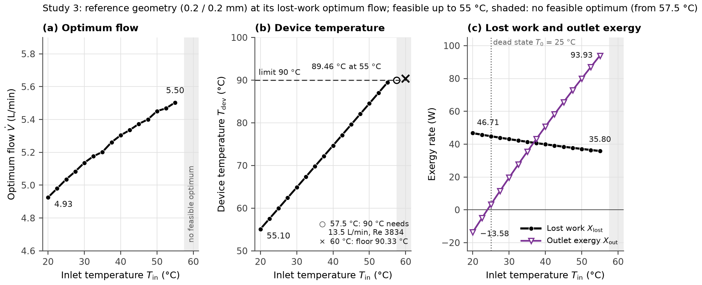

**Figure 15.** Study 3, reference geometry at its lost-work optimum flow: (a) optimum flow, (b) device temperature with the 90 °C limit, (c) lost work and outlet exergy, against inlet temperature. Shaded: no feasible optimum (57.5 °C and above). Open circle: at 57.5 °C, holding 90 °C needs 13.5 L/min and Re 3834. Cross: at 60 °C the floor temperature is 90.33 °C, above the limit at any flow. The dotted line in (c) marks the dead state, T0 = 25 °C (`figures/fig_J3_inlet_temperature.png`).

**Result and physics.**

1. *The optimum flow hardly moves*: 4.93 to 5.50 L/min (+12 %) over 35 K of inlet temperature. All three loss terms scale with temperature in a similar way, so their balance hardly changes. The small rise comes from the water's lower viscosity at higher temperature: the pressure drop at the optimum falls from 18.8 to 13.7 kPa although the flow rises, so pumping becomes cheaper and slightly more flow pays.
2. *The lost work falls*, from 46.71 W at 20 °C to 35.80 W at 55 °C (−23 %). The temperature differences barely change (T_dev − T_in stays between 34.5 and 35.1 K), but they sit at higher absolute temperatures. Entropy generated by heat Q crossing a difference ΔT goes as Q ΔT/T², so the same differences destroy less exergy when everything is warmer.
3. *The outlet water carries more exergy*: X_out rises from −13.58 W at 20 °C to 93.93 W at 55 °C. X_out is negative at 20 °C because water below the dead state (25 °C) has exergy of its own, and warming it toward 25 °C uses that up. At 55 °C the outlet water leaves at 57.6 °C and carries about 94 W of exergy, which a heat-reuse system could recover. In CV-L this exergy is not lost; it leaves with the heat rejected at T_in (Eq. 25).
4. *The device limit takes over between 55 and 57.5 °C.* Because T_dev − T_in stays at about 34.5 to 35 K at the optimum (R_th ≈ 0.0345 to 0.0351 K/W), T_dev reaches 90 °C when T_in is about 55 °C. At 55 °C the entropy optimum is still feasible, with 0.54 K to spare. At 57.5 °C the optimum would exceed 90 °C, and holding 90 °C needs 13.5 L/min, Re 3834, which is far outside the laminar range that the model and the Re limit allow. At 60 °C even the floor (90.33 °C) is above the limit. The crossover is sharp for the reason found in Study 1: above the optimum, extra flow buys very little device temperature, so there is no flow margin to trade.

**For a designer.** At this geometry the second law sets the operating point up to an inlet of 55 °C, which covers the ASHRAE classes up to W45 [5]. Above about 55 °C the device limit sets the design, and more flow cannot meet it in laminar flow. The levers are then the geometry and the TIM. The TIM is 20 K of the roughly 35 K rise, and Study 4 shows that R_TIM moves T_dev by ±10 K. So for warm-water cooling the TIM is worth as much attention as the channels. We ran Study 3 only at the reference geometry. The 0.1 mm lost-work design has a lower thermal resistance (0.0316 against 0.0349 K/W at 30 °C), so its crossover would be a few kelvin higher, but we have not run it. A warmer inlet also lowers the lost work and makes the outlet water more useful for heat reuse, so the second law favours warm-water cooling as far as the device limit allows.

### 10.4 Study 4: sensitivities

At the reference geometry we changed one input at a time and found the new optimum flow. The proposal named R_TIM and the pump efficiency. We added the dead state T0 and the plenum loss coefficient. Table 20 gives the results and Figure 16 shows them.

**Table 20.** Study 4: optimum flow, lost work and device temperature for one input changed at a time (`analysis/results/study4_sensitivity.csv`).

| Input | Value | V̇* (L/min) | X_lost (W) | T_dev (°C) |
|---|---|---|---|---|
| baseline | R_TIM 0.02 K/W, η_pump 0.5, T0 25 °C, K 1.5 | 5.13 | 43.05 | 64.87 |
| R_TIM (K/W) | 0.01 | 5.13 | 43.05 | 54.87 |
| | 0.03 | 5.13 | 43.05 | 74.87 |
| η_pump | 0.3 | 4.27 | 44.57 | 65.43 |
| | 0.7 | 5.80 | 42.12 | 64.53 |
| T0 (°C) | 10 | 5.13 | 40.89 | 64.87 |
| | 35 | 5.13 | 44.50 | 64.87 |
| K_c + K_e | 0 | 5.63 | 42.53 | 64.61 |
| | 3 | 4.80 | 43.46 | 65.06 |

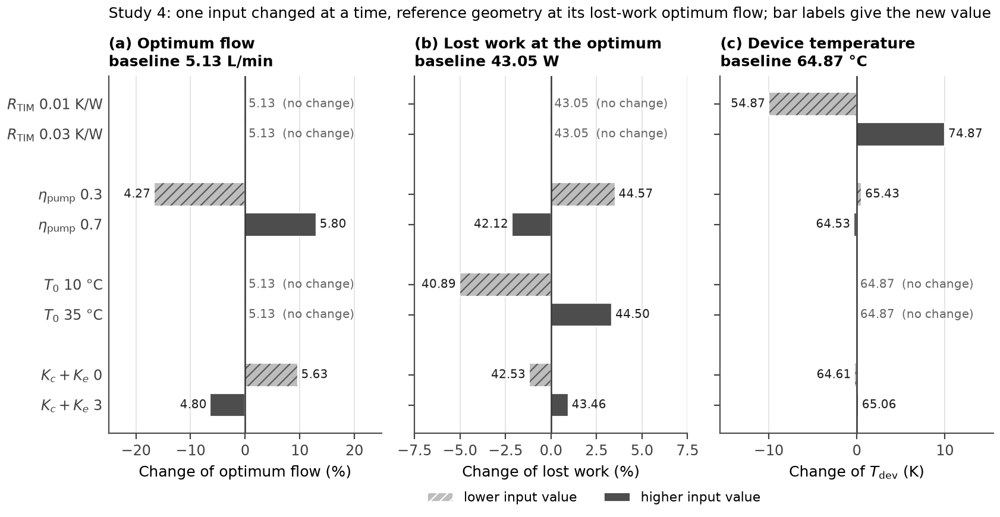

**Figure 16.** Study 4: change of (a) the optimum flow (%), (b) the lost work at the optimum (%) and (c) the device temperature (K) when one input is changed at a time, against the baseline 5.13 L/min, 43.05 W and 64.87 °C. Hatched bars: lower input value; solid bars: higher input value; the bar labels give the new value (`figures/fig_J4_sensitivity.png`).

**Result and physics.**

- *R_TIM (±50 %)* moves T_dev by ±10 K and does not move the optimum flow or the lost work at all. The TIM is in CV-P, outside the objective control volume (section 9.1), so it only uses up device margin.
- *Pump efficiency (0.3 to 0.7)* moves the optimum flow from 4.27 to 5.80 L/min (−17 % / +13 %) and the lost work by −2.2 % to +3.5 %. A better pump makes flow cheaper. Eq. (21) predicts V̇* ∝ η_pump^(1/3), that is 4.33 and 5.74 L/min, close to the 4.27 and 5.80 L/min found.
- *Dead state (10 to 35 °C)* scales the lost work exactly with T0 (40.89 and 44.50 W) and does not move the optimum, because T0 multiplies every term of Eq. (19).
- *Plenum K (0 to 3)* moves the optimum flow from 5.63 to 4.80 L/min (+10 % / −6 %) and the lost work by about ±1 %. Plenum losses grow as V̇², so they make pumping steeper.

**For a designer.** The inputs fall into two groups. R_TIM and the device limit decide whether a design is feasible but not where its optimum is. The pump efficiency and the plenum losses set the price of flow and so move the optimum flow, by up to about 17 %. Neither group changes the lost work at the optimum by more than 3.5 %, because the minimum is flat. And the choice of T0, which is arbitrary to some extent, does not change any design decision.

### 10.5 Phase 1 results: how robust is the design result?

The Phase 1 checks ask whether the headline of Study 2 survives the assumptions we are least sure of.

#### 10.5.1 Channels below the 0.1 mm bound

The lost-work design sits at the 0.1 mm manufacturing bound. To see what the bound costs, we lowered it to 0.05 mm for this study only and ran w_c = w_f from 0.05 to 0.2 mm, each at its own optimum flow under the same limits, plus a free optimization of both widths (Table 21, Figure 17). "Free V̇" is the optimum flow with no constraints.

**Table 21.** Study 5: trend below the 0.1 mm bound (`analysis/results/study5_below_limit.csv`).

| w_c = w_f (mm) | N | V̇ (L/min) [free V̇] | ΔP (kPa) | T_dev (°C) | X_warm / X_gap / X_pump (W) | X_lost (W) | Re | Active limit |
|---|---|---|---|---|---|---|---|---|
| 0.05 | 300 | 1.32 [2.03] | 50.0 | 65.49 | 17.73 / 15.24 / 2.17 | 35.14 | 67 | ΔP |
| 0.075 | 200 | 2.64 [2.64] | 47.3 | 61.33 | 8.89 / 19.04 / 4.09 | 32.03 | 189 | none |
| 0.10 | 150 | 3.17 [3.17] | 32.9 | 61.57 | 7.40 / 22.52 / 3.42 | 33.34 | 298 | none |
| 0.15 | 100 | 4.12 [4.12] | 20.8 | 62.95 | 5.70 / 29.27 / 2.81 | 37.78 | 565 | none |
| 0.20 | 75 | 5.13 [5.13] | 16.9 | 64.87 | 4.60 / 35.62 / 2.84 | 43.05 | 917 | none |
| free: w_c 0.069, w_f 0.050 | 252 | 2.63 | 47.7 | 61.11 | 8.91 / 18.26 / 4.11 | 31.28 | 150 | none (w_f at its bound) |

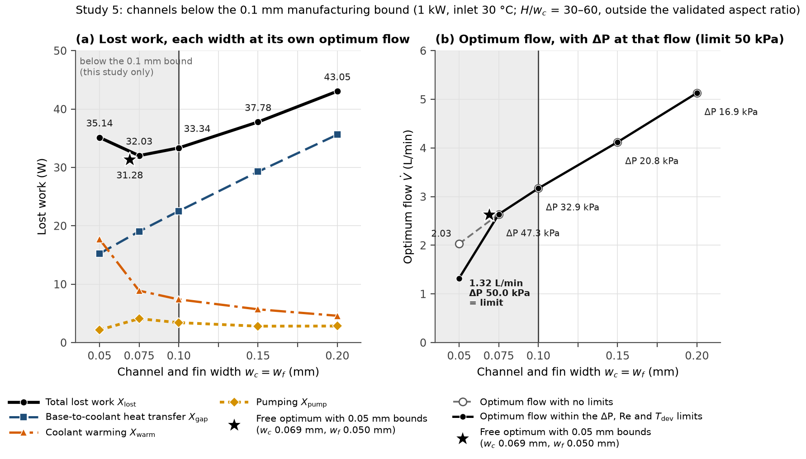

**Figure 17.** Study 5: (a) lost work and its three terms and (b) the optimum flow, with ΔP at that flow, against w_c = w_f, below (shaded) and above the 0.1 mm bound. In (b) the open circle is the optimum flow with no limits and the filled line the optimum within the limits; at 0.05 mm the ΔP limit is active (1.32 L/min, 50.0 kPa). Star: free optimum with 0.05 mm bounds (w_c 0.069 mm, w_f 0.050 mm, 31.28 W). H/w_c is 30–60 here, outside the validated aspect ratio (`figures/fig_J5_below_limit.png`).

**Result and physics.** Narrower channels and fins lower the gap term steadily (35.62 W at 0.2 mm to 15.24 W at 0.05 mm), for the reasons of section 10.2: higher h and more area. But friction per unit flow rises as D_h shrinks, so the optimum flow falls (5.13 to 2.03 L/min unconstrained), and with less flow the warming term grows (4.60 to 8.89 W at 0.075 mm). Down to about 0.07 mm the gain in the gap term wins. At 0.05 mm the ΔP limit takes over and cuts the flow from 2.03 to 1.32 L/min, the warming term jumps to 17.73 W and the lost work rises again. The best design with 0.05 mm bounds (w_c 0.069 mm, w_f at 0.050 mm) has 31.28 W, 6.2 % below the 0.1 mm design. At 0.075 mm the gain is 3.9 %.

**For a designer.** Inside the proposal's range, the lost-work optimum is set by the manufacturing bound and not by the ΔP limit (32.9 of 50 kPa at 0.1 mm). A finer process (about 50 µm, the state of the art quoted in section 4.2 [15]) would gain at most about 6 % of lost work, and the ΔP limit takes over soon after. This is a model trend, not a validated result: H/w_c is 30 to 60 here, far outside the benchmark's 3.1 (section 8.5).

#### 10.5.2 Pump inside or outside the control volume

Table 8 (section 6.6) gives the numbers. With the pump outside CV-L (Ẇ_pump = Ẇ_hyd), pumping is charged at half the price for η_pump = 0.5. Eq. (21) then predicts an optimum flow 2^(1/3) = 1.26 times higher. The runs give 1.26 for the optimum design (3.17 to 3.98 L/min) and 1.29 at the reference geometry (5.13 to 6.61 L/min). The geometry does not change. The lost-work design moves closer to the minimum R_th design, which does not depend on this choice, so the pumping-power saving falls from 63 % to 41 %, the lost-work saving from 10.8 % to 4.7 % and the T_dev penalty from 1.40 to 0.53 K.

For a designer, the right choice depends on who pays for the pump losses. A data-center operator pays for the pump electricity, which is why our default is the pump inside. Someone who only owns the cold plate and buys hydraulic power from the loop would put the pump outside. The geometry recommendation is the same either way; only the optimum flow and the size of the saving change.

#### 10.5.3 Plenum loss coefficient

The plenum losses are the main open point of the validation (section 8.6). We reran the full design optimization for K_c + K_e = 0, 1.5 and 3 (`phase1_plenum_K.csv`). The lost-work design keeps the same geometry. Its flow changes by ±1.5 % (3.12 to 3.22 L/min), its lost work by ±0.3 % (33.23 to 33.45 W) and its T_dev by ±0.06 K. The minimum R_th design changes much more: its flow goes from 6.15 L/min (K = 0) to 5.35 L/min (K = 3), so the pumping-power saving moves between 61 % and 66 %.

The physics is the point of section 10.2 again. Plenum losses grow with the square of the channel velocity. The lost-work design runs at a low velocity (Re 298), so they are a small part of its ΔP, and its flow is not on a constraint anyway. The minimum R_th design sits on the ΔP limit, so every extra pascal of plenum loss directly takes flow away from it. For a designer, the lost-work design is the safer one to build when the manifold losses are not known.

#### 10.5.4 Validated model against the proposal's fully developed model

Table 9 (section 6.8) gives the comparison. On the 1 kW case the two models differ by 1.5 K and 4–12 % at the reference geometry, but give the same optimum geometry and almost the same savings (63.8 % and 11.2 % with the fully developed model, against 63.2 % and 10.8 %). The difference between them is largest where the thermal entry region is longest. At the reference geometry's optimum flow the thermal entry length is about 3 times the channel length (`L_th_over_L` = 3.0 in the CSV), and the optimum flows differ by 12 % (5.13 against 4.53 L/min). At the 0.1 mm design, with its smaller D_h and lower Re, the entry length is about half the channel (`L_th_over_L` = 0.49), most of the channel is close to fully developed, and the optimum flows differ by only 2.1 % (3.17 against 3.10 L/min).

For a designer: the correlation choice matters for predicting T_dev to within about 1.5 K and for the optimum flow of wide, fast channels. It does not change which geometry is best or how much the second-law design saves.

#### 10.5.5 Capping the flow at 2 L/min

Our lost-work design uses 3.17 L/min for 1 kW, more than the 1 to 2 L/min per kW that our proposal quotes as typical industry practice (section 10.2 discusses why). To see what it would cost to stay inside that practice, we reran the Study 2 lost-work optimization with one extra limit, V̇ ≤ 2 L/min. The procedure is the same as for the other Phase 1 optima: grid sweep without the flows above the cap, SLSQP, widths snapped to 1 nm, and the whole-channel flow polish, with the cap as the upper flow bound in every step (`analysis/results/phase1_flow_cap.csv`).

**Table 22.** Minimum lost-work design with and without a flow cap (`phase1_flow_cap.csv`; the row without a cap is copied from `phase1_pump_cv.csv`). Pump inside CV-L, η_pump = 0.5, K_c + K_e = 1.5.

| | No flow cap | V̇ ≤ 2 L/min |
|---|---|---|
| w_c / w_f (mm), N | 0.100 / 0.100, 150 | 0.100 / 0.100, 150 |
| V̇ (L/min), Re | 3.17, 298 | 2.00, 193 |
| ΔP (kPa) | 32.9 | 19.9 |
| T_dev (°C) | 61.57 | 64.07 |
| X_warm / X_gap / X_pump (W) | 7.40 / 22.52 / 3.42 | 11.71 / 22.35 / 1.30 |
| X_lost (W) | 33.34 | **35.37 (+2.03 W, +6.1 %)** |
| Ẇ_hyd [Ẇ_elec] (W) | 1.74 [3.48] | 0.66 [1.33] |
| Limits reached | w_c and w_f at the 0.1 mm bound | flow cap; w_c and w_f at the 0.1 mm bound |

The cap is active and the geometry does not move: both widths stay at the 0.1 mm bound. Capping the flow costs **6.1 % more lost work** (35.37 against 33.34 W). The warming term rises by 4.31 W, as X_warm ≈ B/V̇ predicts (B/V̇ = 23.4/2 = 11.7 W), the pumping term falls by 2.12 W, and the gap term hardly changes (−0.17 W). The hydraulic power falls by 62 % (1.74 to 0.66 W), the pressure drop from 32.9 to 19.9 kPa, and the device runs 2.50 K hotter (64.07 °C), still about 26 K below the limit. Against the minimum R_th design (Table 18: 37.38 W, 4.72 W hydraulic, 60.17 °C), the capped design still has 5.4 % less lost work and 86 % less hydraulic power, for a device 3.90 K hotter.

For a designer: the lost-work minimum is flat enough that a flow limit set by the rest of the loop (pump, CDU, number of cold plates on one manifold) can be met at a small thermodynamic cost, as long as the geometry is the fine 0.1 mm one. The geometry recommendation does not change.

#### 10.5.6 Summary of the robustness checks

**Table 23.** The Study 2 comparison under each changed assumption (minimum lost-work design against minimum R_th design, same constraints). Sources: `phase1_plenum_K.csv`, `phase1_pump_cv.csv`, `phase1_fd_vs_validated.csv`.

| Variant | Lost-work design: w_c / w_f (mm), V̇ (L/min) | Min R_th flow (L/min) | Pumping-power saving | Lost-work saving | T_dev penalty (K) |
|---|---|---|---|---|---|
| Default (validated model, pump inside, η 0.5, K 1.5) | 0.1 / 0.1, 3.17 | 5.66 | 63.2 % | 10.8 % | +1.40 |
| K_c + K_e = 0 | 0.1 / 0.1, 3.22 | 6.15 | 66.1 % | 12.3 % | +1.50 |
| K_c + K_e = 3 | 0.1 / 0.1, 3.12 | 5.35 | 61.0 % | 9.6 % | +1.37 |
| Pump outside CV-L | 0.1 / 0.1, 3.98 | 5.66 | 40.6 % | 4.7 % | +0.53 |
| Fully developed model | 0.1 / 0.1, 3.10 | 5.68 | 63.8 % | 11.2 % | +1.56 |

In every variant the lost-work design has the same geometry, uses less pumping power and less lost work than the minimum R_th design, and runs the device 0.5 to 1.6 K hotter. The size of the pumping saving depends mostly on where the pump is counted (41 % or 63 %). The plenum losses and the correlation choice move it by only a few points. Together with section 10.5.1, the 0.1 mm bound costs at most about 6 % of lost work against a 0.05 mm process, and section 10.5.5 shows that holding the flow to 2 L/min costs 6.1 % with the same geometry.

## 11. Code structure

All results in this report come from one small Python package, `coldplate/`, and a few scripts that run the studies, the validation and the figures. Figure 5 (section 5.6) shows how the modules connect and Figure 6 how one case is solved. The code follows three rules that we set at the start:

- **SI units inside the package** (m, kg, s, K, Pa, W). L/min, °C, mm and µm appear only at the edges (CSV columns, plots, `Result.summary()`), and the name says so (`V_lpm`, `T_dev_C`, `w_c_mm`). Temperatures passed to CoolProp and to the entropy terms are always in kelvin.
- **The benchmark is kept apart from the design case.** The 1 kW case lives in `coldplate/config.py`; the Qu and Mudawar inputs live only in `validation/data/*.csv` and are read by `coldplate/benchmark.py`.
- **Every correlation cites its source** in its docstring and in `docs/equation_sheet.md`, with its validity range.

The sessions of 2026-11-08 (validation, Studies 1–4, first test runs) used Python 3.13 on Linux with CoolProp 8.0.0, NumPy 2.5.3 and SciPy 1.18.1. The Phase 1 checks and the figures were run on Windows, where the environment now has Python 3.12.10, CoolProp 8.0.0, NumPy 2.5.4, SciPy 1.18.1 and Matplotlib 3.11.2.

### 11.1 Modules

Table 24 lists what each module does and what goes in and out of it.

**Table 24.** Modules of the `coldplate/` package.

| Module | Job | Inputs | Outputs |
|---|---|---|---|
| `config.py` | Holds the 1 kW case as dataclasses (`Geometry`, `Operating`, `Materials`, `Limits`, `Losses`, `DeadState`, `Models`) bundled in one `Case`; the defaults are Table 2 and the selected models. `lpm()` and `to_lpm()` convert flow at the edges. | – | a `Case` |
| `properties.py` | CoolProp wrapper. | T (K), P (Pa), fluid | ρ, μ, c_p, k, Pr, h, s; T(h, P) |
| `geometry.py` | `derive()`: channel count, D_h, aspect ratio and areas (Eq. 1). N is a whole number, or fractional for the optimizer, or fixed (21 for the benchmark). | `Geometry` | `DerivedGeometry` |
| `correlations.py` | Nusselt models `fd_H1`, `fd_H1_3`, `LG`, `LG_3`, `MY`, `MY_3` through `local_nusselt()` (Eqs. 8–11); friction models `fd`, `MY`, `hagenbach` through `apparent_fRe()` (Eqs. 14, 15); entry lengths. | x, Re, Pr, w_c, H, L | Nu_x(x), f_app Re, entry lengths |
| `hydraulic.py` | `pressure_drop()`: velocity, Re, friction and plenum losses, Ẇ_hyd and Ẇ_elec (Eqs. 2, 13–16). | geometry, properties at the mean state, ṁ, `Losses`, friction model, wall-corrected viscosity from `thermal.py` | `HydraulicResult` |
| `thermal.py` | `solve_thermal()`: the network of Figure 3 station by station, with local h(x), fin efficiency, axial conduction in the base and the wall-viscosity passes (Eqs. 3–7, 12). `temperature_below_channels()` gives the benchmark thermocouple temperatures. | geometry, properties, Q, ṁ, inlet state, P_in and P_out, Re, model choices | `ThermalResult`: T_f(x), T_cf(x), T_b(x), T_out, T̄_f, T̄_s, T_dev, length-mean Nu and h, resistances, friction viscosity |
| `second_law.py` | `entropy_generation()`: CV-C (exact boundary integral and mean-temperature form), CV-L and its three terms, CV-P, X_lost and the outlet exergy; `flow_exergy()` (Eqs. 17–22). | `ThermalResult`, `HydraulicResult`, Q, ṁ, inlet and outlet states, dead state, pump placement | `SecondLawResult` |
| `model.py` | `evaluate(case)`: the coupled solution of Figure 6, then the second-law terms, entry lengths and constraint margins. | a `Case`; options for the models, the number of stations, the tolerance and the channel count | `Result`: all sub-results, `R_th`, `margins`, `feasible`, `summary()` in report units |
| `optimize.py` | The studies: `flow_sweep()` and `optimum_flow()` (bounded scalar search plus the Eq. 21 check), `grid_sweep()`, `optimize_design()` (SLSQP with fractional N, then the whole-channel flow polish, section 6.7), `compare_designs()`, `inlet_temperature_sweep()`. Objectives: lost work, R_th, Ẇ_hyd. | a `Case`, grids and bounds | `FlowOptimum`, `DesignOptimum` |
| `benchmark.py` | Builds the Qu and Mudawar case from `validation/data/*.csv` only (assumptions B1–B5). `flow_from_reynolds()`, `predict()` (TC1–TC4, ΔP, water temperature rise), `compare()` (point errors and MAPE). | data CSVs, heat flux, Re, model choices | `Prediction`; errors and MAPE |

**How they connect.** A design is one `Case`. `model.evaluate()` derives the geometry once, then iterates: properties at the mean water state → `hydraulic.pressure_drop()` → `thermal.solve_thermal()`, which returns T_out and the wall-corrected friction viscosity for the next pressure-drop pass, until T_out and ΔP stop changing (Figure 6). It then calls `second_law.entropy_generation()` and checks the limits. Everything above `model.py` calls only `evaluate()`: `optimize.py` evaluates copies of the case with new widths, flow or inlet temperature (`with_design()`), and `benchmark.py` evaluates its own case with 21 channels, R_TIM = 0, no limits and the experiment's heat input and flow. No study or validation script repeats any physics.

**Scripts.** Table 25 lists the scripts that write the results and figures. Appendix C maps each table and figure of this report to its command.

**Table 25.** Scripts.

| Script | What it does | Writes |
|---|---|---|
| `analysis/run_studies.py` | Studies 1–5 (`--only N` runs one study, `--quick` uses coarser grids) | `analysis/results/study1_…` to `study5_….csv`; also two early draft plots (`figures/study1_flow_sweep.png`, `figures/study3_inlet_temperature.png`) that this report does not use |
| `analysis/run_phase1_checks.py` | Phase 1 checks, parts `d7 d5 fd num digit cap` | `analysis/results/phase1_*.csv` |
| `analysis/make_report_figures.py` | Figures 3–9 and 12–17 from the CSVs, the data files and the code; reruns no study | `figures/fig_*.png` |
| `analysis/make_geometry_figures.py` | Figures 1 and 2 | `figures/geometry_*.png` |
| `validation/run_validation.py` | Model matrix of Tables 6 and 7; `--plots` parity plot (Figure 11); `--vs-re` data and model against Re (Figure 10) | `validation/results/*.csv`, `figures/validation_*.png` |
| `validation/digitize/` | Digitizing pipeline of section 7.5 (`qm_figures.py`, then `fill_csv.py`) | `validation/data/raw/`, `validation/data/qu_mudawar_*.csv` |

### 11.2 How to run

Set-up, from the repository folder:

```
python -m venv .venv
.\.venv\Scripts\activate          (Linux / macOS: source .venv/bin/activate)
pip install -r requirements.txt
pip install -e .
```

Then:

```
python -m pytest -q                              # tests
python analysis/run_studies.py                   # Studies 1-5
python analysis/run_phase1_checks.py             # Phase 1 checks (all parts)
python validation/run_validation.py              # validation matrix
python analysis/make_report_figures.py           # Figures 3-9, 12-17
python analysis/make_geometry_figures.py         # Figures 1-2
```

On Windows we set `$env:OPENBLAS_NUM_THREADS=1` in PowerShell first. NumPy otherwise threads the many small dense solves of the thermal network, and the test suite took 47 min instead of 24 min. On Linux the suite took about 4 min.

### 11.3 Tests

The test suite has 51 tests in eight files (`tests/`). The last full run on Windows (2026-11-16) gave **50 passed, 1 skipped**: the digitizer test needs Node.js, which is not installed on that machine, so it has only been run on Linux (51 passed there on 2026-11-08). Table 26 lists what the tests check.

**Table 26.** Test coverage.

| File (tests) | What is checked |
|---|---|
| `test_properties.py` (3) | water ρ, c_p, μ, k at 25 °C and ρ, μ at 60 °C against reference values; T(h, P) round trip |
| `test_geometry_correlations.py` (4) | channel count and D_h; parallel-plate limits of Nu and fRe; square duct; a plate too narrow for one channel raises an error |
| `test_correlations_developing.py` (19) | fully developed limits; Lee–Garimella entry-length definition (7 aspect ratios), agreement with the Wibulswas table (aspect ratios 3 and 4) and approach to the fully developed value; Muzychka–Yovanovich circular-tube limit, square-duct friction, thermal part against Wibulswas, combined above thermal-only; apparent friction against Shah and London (3 aspect ratios); all friction models tend to the fully developed value; model registry and error handling |
| `test_hydraulic_thermal.py` (7) | Poiseuille parallel-plate limit; friction ΔP ∝ V̇ and minor losses ∝ V̇²; a pump efficiency outside (0, 1] is rejected; fin-efficiency limits; energy balance and the temperature order T_in < T̄_f < T_out < T̄_s < T_dev; doubling the flow lowers T_dev but more than quadruples Ẇ_hyd; T_dev stays above the floor T_in + Q(R_conv + R_base + R_TIM) |
| `test_second_law.py` (7) | Ṡ_gen > 0 for CV-C, CV-L, CV-P and each CV-L term over 0.5–8 L/min; the three CV-L terms sum to Eq. (19) to 10⁻¹²; mean-temperature CV-C and its split within 1 % of the exact value (A1); flow exergy zero at the dead state; interior lost-work optimum, Eq. (21) within 20 % of it and X_warm/X_pump between 1.5 and 3.5; with fully developed flow Ṡ_gen,C only rises with flow; with developing flow it stays positive |
| `test_benchmark_optimize.py` (5) | benchmark geometry loads from the CSVs; the Re definition reproduces the paper's stated flow rates; prediction trends (ΔP above friction alone, TC1 < TC2 < TC3 < TC4, more flow gives more ΔP and less water warming); `compare()` runs; the minimum R_th optimization returns a feasible design better than its start |
| `test_validation_qm.py` (5) | regression guard on the validation: data present (≥ 35 ΔP and ≥ 150 thermocouple points); selected model thermocouple MAPE < 10 %, water-rise MAPE < 5 %, ΔP MAPE < 15 %; fully developed model thermocouple MAPE > 30 % |
| `test_digitizer.py` (1) | the digitizing pipeline recovers the markers of a synthetic plot within 0.3 % of the axis range (needs Node.js) |

What the tests do not cover: the study results themselves (no test compares a study CSV with stored numbers), the convergence of the optimizer beyond feasibility, the wall-viscosity loop (a fixed 4 passes, section 11.4), and the plotting scripts, which we checked by eye.

### 11.4 Numerical checks

In Phase 1 we checked that the numbers do not depend on the numerical settings (`analysis/results/phase1_numerical_checks.csv`). Table 27 gives the grid check: the same case solved with 21, 41 and 81 stations along the channel.

**Table 27.** Grid independence.

| Quantity | n_x = 21 | 41 | 81 | change 41 → 81 |
|---|---|---|---|---|
| 1 kW reference design, 2 L/min: T_dev (°C) | 69.052 | 69.017 | 69.008 | −0.010 K |
| same: ΔP (kPa) | 5.3224 | 5.3220 | 5.3218 | −0.003 % |
| same: X_lost (W) | 48.642 | 48.660 | 48.668 | +0.016 % |
| Qu and Mudawar, 100 W/cm², Re 1672: TC1 (°C) | 33.716 | 33.762 | 33.783 | +0.022 K |
| same: TC4 (°C) | 47.450 | 47.465 | 47.464 | −0.0003 K |
| same: friction ΔP (kPa) | 72.773 | 72.753 | 72.744 | −0.011 % |

- **Grid.** The defaults are 41 stations for the 1 kW case, 61 for the benchmark (between the 41 and 81 of Table 27) and 21 inside the optimizer, whose final designs are re-evaluated with 41. All are converged to about 0.01–0.05 K and 0.05 % or better, far below the 4.6 % validation error.
- **Energy balance.** For the reference design ṁ(h_out − h_in)/Q − 1 = 3 × 10⁻¹¹, and the convective heat integrated along the channel matches Q to 2 × 10⁻¹³ on all three grids. The solver rescales the convective heat so that the water receives exactly Q, so this closure holds by construction. It confirms the implementation; it is not an independent check.
- **Property iteration.** Converged in 3 iterations at the default tolerance (10⁻⁶ K). With 10⁻¹⁰ K (9 iterations) T_dev is unchanged to 8 decimals, ΔP changes by 2 × 10⁻⁸ kPa and X_lost by about 10⁻⁹ W.
- **Optimizer.** The integer-channel issue of section 6.7 (a width returned as 0.1000000000028 mm drops N from 150 to 149 and changes X_lost by 0.3 %) is handled in the Phase 1 runs by snapping the widths to 1 nm.
- **Not checked.** The wall-viscosity loop in `thermal.py` runs a fixed 4 passes with no convergence test; checking it needs a code change.

## 12. Conclusions

The central question of the proposal (section 2) was: how much coolant flow is thermodynamically worthwhile before the extra friction losses outweigh the reduction in heat-transfer irreversibility, and how do the channel geometry, the device temperature limit and the coolant inlet temperature change that optimum? Our answers, for the 1 kW, 30 × 30 mm case with the model validated against Qu and Mudawar [1] (4.6 % thermocouple MAPE, 9.7 % pressure-drop MAPE):

1. **How much flow.** For 0.2 mm channels and fins, the lost work is lowest at 5.13 L/min (43.05 W), about 5 L/min per kW. The simple estimate V̇* = (B/2C)^(1/3) gives 4.77 L/min. The full model's optimum is higher because, with developing flow, extra flow also lowers the base-to-coolant loss (section 9.3). The minimum is flat: anything from 3 to 7.5 L/min is within 5 %. Above the optimum, friction wins: going from 5 to 10 L/min multiplies the hydraulic power by 5.0 and lowers the device temperature by only 1.65 K. The reference flow of 2 L/min, at the upper end of the 1 to 2 L/min per kW that our proposal quotes as typical practice, loses 13 % more than the optimum at this geometry.
2. **What limits the benefit of flow.** Heat transfer from the base to the coolant is the largest irreversibility: 83 % of the lost work at the flow optimum and two thirds in the optimized design. Flow changes it by only a few watts over a 20-fold range, so more flow cannot fix a poor geometry.
3. **Geometry matters more than flow.** Optimizing the channel width, fin thickness and flow together gives 0.1 mm channels and fins at 3.17 L/min, with X_lost = 33.34 W. That is 22.5 % below the 0.2 mm geometry at its own best flow, while optimizing the flow alone gave 11.5 %. Narrower channels need less flow. The optimum sits on the 0.1 mm manufacturing bound, and a 0.05 mm process would gain at most about 6 %.
4. **Second-law design against minimum thermal resistance.** The lost-work design uses 63 % less pumping power (1.74 against 4.72 W hydraulic) and has 10.8 % less lost work, for a device 1.40 K hotter (61.57 against 60.17 °C), with 28 K of margin left to the 90 °C limit. The minimum thermal resistance design is set by the 50 kPa pressure-drop limit; the lost-work design is set by thermodynamics, with its pressure drop (32.9 kPa) well inside the limit. The 63 % assumes the pump inside the control volume with η_pump = 0.5; with the pump outside it is 41 %. Its 3.17 L/min is above the 1 to 2 L/min per kW of current practice, because the objective charges the warming of the coolant as lost work and leaves out rack-level limits (section 10.2); capping it at 2 L/min costs only 6.1 % more lost work.
5. **Device temperature limit.** At a 30 °C inlet the limit is not active for any of the lost-work designs. The TIM takes 20 K of the device temperature rise. R_TIM moves T_dev by ±10 K but does not move the lost-work optimum, because the TIM lies outside the cold plate's control volume. The device limit decides feasibility, not the optimum.
6. **Inlet temperature.** From 20 to 55 °C the optimum flow barely changes (4.93 to 5.50 L/min), the lost work falls from 46.7 to 35.8 W, and the exergy carried by the outlet water rises to 94 W, which favours warm-water cooling and heat reuse. At the reference geometry the device limit takes over between 55 and 57.5 °C. Above that, the 90 °C limit cannot be met with laminar flow (at 57.5 °C it would need Re 3834), and from 60 °C it cannot be met at any flow.
7. **The control volume is part of the answer.** The cold plate alone (CV-C) has no useful optimum flow: its entropy generation is flat within 0.5 % from 0.5 to 4.5 L/min. The coolant-warming loss only appears when the return of the water to its inlet temperature is included (CV-L). The design conclusions hold for plenum loss coefficients of 0 to 3 (saving 61–66 %) and with the proposal's fully developed model (saving 64 %), although the two models differ strongly on the benchmark.

## 13. Limitations and future work

### 13.1 Limitations

1. **Aspect-ratio extrapolation.** The model is validated at H/w_c = 3.1. The design case has H/w_c = 15 (reference) to 30 (the 0.1 mm optimum), and the study below the bound goes to 60 (section 8.5). The Muzychka-Yovanovich model has no aspect-ratio limit, and the fully developed model, which does not use the developing-flow correlations at all, gives the same design (Table 9). Still, the design numbers are an extrapolation of the validation, not a validated result.
2. **Plenum losses unresolved (D5).** The benchmark pressure drop agrees best with no plenum losses (9.7 %), which cannot be exactly right, and the paper's "close to unity" coefficients over-predict by 27 % (section 8.6). For the 1 kW case K_c = 0.5 and K_e = 1.0 are assumed without a source. Section 10.5.3 shows that the lost-work design hardly depends on K. The minimum R_th design, and with it the size of the saving (61–66 %), does.
3. **Assumed limits and parameters.** T_dev,max = 90 °C, R_TIM = 0.02 K/W and η_pump = 0.5 are our assumptions, without primary sources (D6, A9, A12), and so are the 50 kPa budget and T0 = 25 °C. R_TIM and T_dev,max decide where the device limit takes over (Study 3), and η_pump moves the optimum flow from 4.27 to 5.80 L/min (Study 4). The headline saving also depends on putting the pump inside the control volume (D7).
4. **Uniform heat flux (A2).** Real processors have hot spots, so the real hottest point would be hotter than our T_dev, and the base-to-coolant loss would be distributed differently along the channel. Base conduction is one-dimensional, without lateral spreading (A3).
5. **Equal flow per channel (A5).** We do not model the manifold. Maldistribution would leave some channels with less flow and higher wall temperatures, and the plenum losses would depend on the manifold shape.
6. **Other simplifications and open items.** CV-L idealizes the coolant distribution unit as a reservoir at T_in; it is not a model of the whole loop. Study 3 was run only at the reference geometry. CV-P is not written to the results CSVs (its size in section 9.1 is a hand estimate checked against one model evaluation). The open items of the validation also apply here: one benchmark, viscosity exponents not yet checked in the original source, and the hand check of the digitized data still pending (section 8.6).
7. **The optimum flow is for one cold plate whose heat is thrown away.** Our design flow, about 3.2 L/min per kW, is above the 1 to 2 L/min per kW of current practice. Two things in the problem set-up push it there (section 10.2). The objective counts the warming of the coolant as lost work, because the warm water is assumed to be rejected at T_in; with heat reuse the warming loss would shrink and the optimum would move to lower flow (an argument from Eq. 26, not a run). And rack-level limits on the pump and the coolant distribution unit are not modelled. The result should therefore be read as the thermodynamic optimum of one cold plate. It still uses 44 % less flow than the minimum thermal resistance design (5.66 L/min), and capping it at 2 L/min costs only 6.1 % more lost work (section 10.5.5).

### 13.2 Future work

1. **CFD check of the optimum design.** A three-dimensional conjugate CFD model of a few channels of the 0.1 mm design at 3.17 L/min would check the local h, the pressure drop and the device temperature at the aspect ratio (H/w_c = 30) that our validation does not cover.
2. **A tall-channel benchmark.** Repeat the validation against an experiment with H/w_c of 10 or more, close to skived-fin cold plates, to remove the main extrapolation.
3. **Two-phase cooling.** In flow boiling the coolant absorbs heat at nearly its saturation temperature, so we expect the coolant-warming loss, which sets the single-phase optimum, to be replaced by losses tied to the saturation temperature and the two-phase pressure drop. The same CV-L framework could compare a two-phase cold plate (for example the type modelled by Wang et al. [16]) with the single-phase optimum.
4. **A manifold and flow-distribution model.** Model the inlet and outlet plenums and the flow split between channels. This would replace the equal-flow assumption (A5) and the assumed K values, and would give plenum losses for the benchmark as well (D5).
5. **Smaller extensions with the existing code.** Run Study 3 on the 0.1 mm lost-work design; write CV-P to the results; repeat Study 2 for a range of heat loads to see how the optimum flow scales with Q; add a heat-reuse variant of CV-L, in which the outlet exergy is a product, to find how far the optimum flow moves down (section 10.2).

## 14. References

Only sources already cited in the project documents are listed. Entries marked *incomplete* need their full bibliographic details added from the original before submission.

1. W. Qu and I. Mudawar, "Experimental and numerical study of pressure drop and heat transfer in a single-phase micro-channel heat sink," Int. J. Heat Mass Transfer, vol. 45, pp. 2549–2565, 2002.
2. D. B. Tuckerman and R. F. W. Pease, "High-performance heat sinking for VLSI," IEEE Electron Device Lett., vol. EDL-2, no. 5, pp. 126–129, 1981.
3. A. Bejan, Entropy Generation Minimization. Boca Raton, FL: CRC Press, 1996.
4. W. A. Khan, M. M. Yovanovich and J. R. Culham, "Optimization of microchannel heat sinks using entropy generation minimization method," IEEE Trans. Compon. Packag. Technol., 2009, doi:10.1109/TCAPT.2009.2022586.
5. ASHRAE TC 9.9, Thermal Guidelines for Data Processing Environments, 5th ed. Atlanta, GA: ASHRAE, 2021.
6. R. K. Shah and A. L. London, Laminar Flow Forced Convection in Ducts. New York: Academic Press, 1978. (Page and equation numbers of the fits not yet verified.)
7. T. L. Bergman, A. S. Lavine, F. P. Incropera and D. P. DeWitt, Fundamentals of Heat and Mass Transfer, 7th ed. Wiley, 2011.
8. I. H. Bell et al., "Pure and pseudo-pure fluid thermophysical property evaluation and the open-source thermophysical property library CoolProp," Ind. Eng. Chem. Res., vol. 53, pp. 2498–2508, 2014.
9. P.-S. Lee and S. V. Garimella, "Thermally developing flow and heat transfer in rectangular microchannels of different aspect ratios," Int. J. Heat Mass Transfer, vol. 49, pp. 3060–3067, 2006. Used: Eqs. (11)–(13), (15), (16).
10. Y. S. Muzychka and M. M. Yovanovich, "Laminar forced convection heat transfer in the combined entry region of non-circular ducts," ASME J. Heat Transfer, vol. 126, pp. 54–61, 2004. Used: Eqs. (21), (22), (42)–(47), Table 1.
11. P.-S. Lee, S. V. Garimella and D. Liu, 2005, Table 2 (Wibulswas Nu_x values). *Incomplete: title and journal.*
12. Duan and Ma, 2020, Table 3 (Shah and London apparent friction values) and Eq. (33) (Hagenbach factor, attributed to Steinke and Kandlikar). *Incomplete: full citation.*
13. W. M. Kays and M. E. Crawford, Convective Heat and Mass Transfer, 3rd ed., 1993. Exponents quoted through the `ht` Python library (`wall_factor`); original table not yet checked.
14. WebPlotDigitizer, https://automeris.io/WebPlotDigitizer (source used headless, AGPL-3.0; commit recorded in `validation/digitize/wpd_core/SOURCE_COMMIT.txt`).
15. T. Shedd, "The Skinny on Skived Cold Plates," https://timshedd26.substack.com/p/the-skinny-on-skived-cold-plates
16. Q. Wang et al. (Accelsius), "Thermohydraulic Modeling of Microchannel Cold Plates for Two-Phase Data Center Cooling," IEEE ITherm, https://accelsius.com/wp-content/uploads/Thermodynamic-Modeling-of-Microchannel-Cold-Plates-Q.-Wang.pdf
17. FiberMall blog, NVIDIA GB200 liquid cooling plate, https://www.fibermall.com/blog/nvidia-gb200-liquid-cooling-plate.htm (vendor blog; claims without a primary source).

## Appendix A. Assumptions

Table 4 (section 5.7) lists the modelling assumptions by their IDs in `docs/equation_sheet.md`. This appendix collects every assumption behind the results in one place, together with what we did to test it and how much it matters. Table A1 covers the model, Table A2 the assumed inputs and limits of the 1 kW case, and Table A3 the benchmark.

**Table A1.** Modelling assumptions.

| ID | Assumption | Basis | Tested how, and effect | Section |
|---|---|---|---|---|
| – | Steady, single-phase, laminar flow | proposal; the correlations are laminar | enforced by Re ≤ 2000; the limit is reached only above about 11.4 L/min at the reference geometry, and when holding 90 °C at a 57.5 °C inlet | 5, 10.1, 10.3 |
| A1 | Heat enters CV-C at one mean temperature | proposal's Ṡ_gen formula | not used: the code uses the exact integral; the mean form changes Ṡ_gen,C by 0.15 % (reference design) | 5.5, 9.1 |
| A2 | Uniform heat flux, 1000 W over 30 × 30 mm | proposal; keeps the model one-dimensional | not tested; real hot spots would raise T_dev | 13.1 |
| A3 | 1D conduction through the base, no lateral spreading | footprint equals heated area | not tested for the 1 kW case | 13.1 |
| A4 | Hottest device point above the outlet | proposal | replaced: T_dev from the maximum of T_b(x), Eq. (7) | 5.2 |
| A5 | Equal flow in every channel | proposal | not tested; no manifold model | 13.1 |
| A6 | Adiabatic lid and fin tip; three walls heated | cold-plate lid; benchmark polycarbonate cover | three-sided correction, Eq. (9): 2.0–4.6 MAPE points better on the benchmark | 6.2 |
| A7 | Fully developed flow | proposal | failed: 49.1 % thermocouple MAPE; replaced by Eqs. (8) and (14) | 6.1 |
| A10 | No wall-viscosity correction | proposal | replaced by Eq. (12); exponents 0.14 and 0.58 from the `ht` library, original table not checked | 6.4, 8.6 |
| A11 | Viscous heating left out of T_out | under 0.01 K | accepted; ΔP still enters the entropy balance through s(T, P) | 5.4 |
| A14 | No axial conduction in the base | proposal | replaced by Eq. (6): 1.8–2.6 MAPE points better for the developing-flow models | 6.3 |
| – | Three-sided ratio of Eq. (9) applied to `MY` | our extension of Eq. (15) of [9] | `LG_3`, which is fully sourced, gives the same accuracy (4.5 % against 4.6 %) | 6.1 |
| – | CV-L: the cooler is a reservoir at T_in, and the outlet heat is not reused | proposal | not varied; it creates the warming loss and pushes the optimum flow up | 9.1, 10.2 |
| D7 | Pump inside CV-L, Ẇ_pump = Ẇ_elec | our choice | pump outside: same geometry, 26 % more flow, pumping-power saving 41 % instead of 63 % | 6.6, 10.5.2 |
| – | Fractional channel count during SLSQP; widths snapped to 1 nm in the Phase 1 runs | our choice | whole-channel polish of every reported design; the snapping avoids a 0.3 % error from N = 149 | 6.7 |

**Table A2.** Assumed inputs and limits of the 1 kW case.

| Quantity | Value | Basis | Sensitivity and effect | Section |
|---|---|---|---|---|
| Heat load and footprint | 1000 W on 30 × 30 mm | proposal: power class of current AI accelerators | fixed; scaling with Q not studied (future work) | 4.1 |
| Plate material | copper, k_s = 390 W/m·K | proposal | fixed | 4.1 |
| H, t_b, L = W | 3 mm, 1 mm, 30 mm | proposal; inside the published ranges of Table 3 | fixed, so that the optimization has three variables | 4.1, 4.2 |
| R_TIM (A12) | 0.02 K/W | assumed, no primary source (D6) | 0.01–0.03 K/W moves T_dev by ±10 K; the optimum flow and the lost work do not move | 10.4 |
| T_dev,max (A12) | 90 °C | assumed, no primary source (D6) | not active for the lost-work designs at a 30 °C inlet; takes over between 55 and 57.5 °C inlet at the reference geometry | 10.3 |
| ΔP budget | 50 kPa | assumed in the proposal | not active for the lost-work design (32.9 kPa); sets the minimum R_th design | 10.2 |
| Re limit | 2000 | laminar correlations | see the first row of Table A1 | 10.1 |
| Width bounds | w_c 0.1–1.0 mm, w_f 0.1–0.5 mm | proposal; Shedd [15] | the lost-work optimum sits on the 0.1 mm bound; a 0.05 mm bound gains at most about 6 % | 10.5.1 |
| Plenum losses (A8) | K_c = 0.5, K_e = 1.0 | assumed, no source (D5) | K_c + K_e = 0–3: optimum flow at the reference geometry 5.63 to 4.80 L/min; lost-work design ±1.5 % in flow and ±0.3 % in X_lost; pumping-power saving 61–66 % | 10.4, 10.5.3 |
| Pump efficiency (A9) | 0.5 | assumed | 0.3–0.7: optimum flow 4.27 to 5.80 L/min, lost work +3.5 % to −2.2 % | 10.4 |
| Dead state (A13) | T0 = 25 °C, P0 = 101.325 kPa | T0 from the proposal; P0 standard atmosphere | T0 = 10–35 °C scales the lost work with T0; the optimum flow does not move | 10.4 |
| Inlet temperature | 30 °C | ASHRAE W32 class (proposal) | Study 3: 20–60 °C | 10.3 |
| Inlet pressure | 2 bar | assumed | small effect on properties; P_out must stay above 10 kPa | 5.4 |

**Table A3.** Benchmark assumptions (`coldplate/benchmark.py`, `validation/README.md`).

| ID | Assumption | Basis | Tested how, and effect | Section |
|---|---|---|---|---|
| B1 | Re uses inlet-temperature properties | paper's Re defined with inlet parameters | reproduces the paper's stated flow rates within 0.7 % | 7.2 |
| B2 | Q = q″_eff × A_t enters uniformly; heat loss neglected | paper: heat loss < 1 % | at 200 W/cm² the measured water rise is 2.5–5.7 % below the energy balance, inside the 4 % flow uncertainty plus heat loss | 7.6 |
| B3 | Plenum losses either left out (selected) or K_c = K_e = 1 at channel velocity | paper: coefficients "close to unity", no values or plenum dimensions | ΔP MAPE 9.7 % without, 26.7 % with; unresolved (D5) | 6.5, 8.6 |
| B4 | Inlet pressure 2 bar | not reported in the paper | small effect on properties | 7.2 |
| B5 | Thermocouple temperature = channel-floor temperature + q″d/k_s, d = 2.462 mm | 1D conduction; d from Table 1 of the paper | TC1 at 200 W/cm² under-predicted by up to about 8 % at low Re; 3D conduction near the inlet is a possible cause, not tested | 8.6 |
| – | A marker's value is its area centroid | digitizing (section 7.5) | for triangles the plotting anchor could be the bounding-box centre, about 0.4 K higher; the reading uncertainty moves the MAPE by about 0.1 point | 7.6, 8.4 |

## Appendix B. Checklist against the proposal

Table B1 takes each promise of the submitted proposal (`docs/proposal_submitted.md`) and gives where this report delivers it, or what changed and why.

**Table B1.** Proposal promises and where they are delivered.

| Proposal promise | Where in this report | Status |
|---|---|---|
| Reduced-order Python model of a water-cooled copper microchannel cold plate | sections 5, 11 | delivered |
| Objective 1: device temperature, pressure drop and pump power for any w_c, w_f and flow | sections 5, 11 (`model.evaluate()`) | delivered |
| Objective 2 and validation plan: run at the Qu and Mudawar conditions (21 channels, 231 × 713 µm), compare measured ΔP and temperatures, errors within about 10–15 % | sections 7, 8; Table 14 | delivered: 4.6 % thermocouple and 9.7 % ΔP MAPE, no tuning; the ΔP result leaves out plenum losses, which is unresolved (section 8.6) |
| Fallback: switch to a developing-flow Nusselt correlation if the error is too large | sections 3, 6.1 | used: the fully developed model gave 49 %, so we switched to developing flow and also added three-sided heating, axial conduction, a wall-viscosity correction and apparent friction (Table 1) |
| 1D resistance network in series: TIM, base, fin-array convection, coolant rise | section 5.2, Figure 3 | changed: the same chain, solved station by station along the channel, because h now depends on x |
| Fully developed Nu and fRe (Shah and London), standard fin efficiency, CoolProp properties | sections 5.2–5.4, 6 | changed for Nu and friction (validation); fin efficiency and CoolProp as proposed |
| Hottest device point above the outlet | section 5.2, Eq. (7) | changed: maximum of T_b(x) along the channel (A4) |
| Objective 3: entropy generation split into its sources and expressed as lost work | sections 5.5, 9.1, 9.2 | delivered: three control volumes; CV-L split into warming, gap and pumping terms |
| Control volume: cold plate plus the return of the coolant to T_in; Ṡ_gen = Q(1/T_in − 1/T_s) + Ẇ_pump/T_in, X_lost = T0 Ṡ_gen | sections 5.5, 9.1; Eqs. (19), (25) | delivered; the placement of the pump in the control volume is made explicit and tested (section 6.6) |
| Optimum flow ≈ (B/2C)^(1/3); check the numerical optimum against it | section 9.3 | delivered: 4.77 against 5.13 L/min; the difference is explained by Eq. (28) |
| First estimate: optimum flow of about 4 to 5 L/min for 0.2 mm channels | sections 9.3, 10.1 | 5.13 L/min with the validated model (4.53 L/min with the proposal's model), just above the range because h rises with velocity in developing flow |
| Study: flow sweep at the reference geometry (0.2 mm channels and fins) | section 10.1, Table 17, Figure 13 | delivered, 0.5–12 L/min |
| Objective 4 and study: optimize w_c, w_f and flow (grid sweep, then SLSQP) to minimize lost work with T_dev ≤ 90 °C, ΔP ≤ 50 kPa, laminar flow; compare with the minimum thermal resistance design | sections 6.7, 10.2; Table 18, Figure 14 | delivered; whole-channel polish added; minimum hydraulic power design added as an extra reference |
| Objective 5 and study: inlet temperature 20 to 50 °C; when the temperature limit takes over; exergy of the outlet water | section 10.3, Table 19, Figure 15 | delivered at the reference geometry; range extended to 60 °C because the limit takes over between 55 and 57.5 °C; not run for the 0.1 mm design |
| Sensitivity of the TIM resistance and the pump efficiency | section 10.4, Table 20, Figure 16 | delivered; T0 and the plenum loss coefficient added |
| Inputs: 1000 W on 30 × 30 mm, copper 390 W/m·K, 3 mm fins, 1 mm base, R_TIM 0.02 K/W, water at 30 °C, T0 = 25 °C, w_c 0.1–1.0 mm, w_f 0.1–0.5 mm, 0.5–12 L/min | Table 2 | as proposed; extra study below the 0.1 mm bound (section 10.5.1) |
| Second-law check: entropy generation positive everywhere | section 9.5 | delivered (all CSV values, and a test) |
| Second-law check: warming loss about twice the pumping loss at the optimum | sections 9.3, 9.5 | 1.62 with the validated model and 2.43 with the fully developed model; both departures explained by Eq. (28) |
| Main assumptions: steady single-phase laminar flow, uniform heat flux, equal flow in all channels | Table 4, Appendix A | kept; listed as limitations (section 13.1) |
| Tools: Python (NumPy, SciPy, Matplotlib) with CoolProp on a laptop | section 11 | delivered |
| Code on GitHub, updated every week | repository github.com/krishna24558/coldplate-egm | the history has commits on 23 Oct, 13 Nov, 16 Nov, 20 Nov and 22 Nov 2026; there were none between 23 Oct and 13 Nov, so the weekly updates were not kept in that period |
| Timeline: model and tests by Nov 3, validation and second-law module by Nov 12, studies by Nov 22, report and code by Dec 3 | – | model, tests, validation, second-law module and Studies 1–4 done on 8 Nov (model and tests five days late); data recheck 13 Nov; Phase 1 checks 16 Nov; flow-cap check 22 Nov; this report for 3 Dec |
| References of the proposal [1]–[8] | section 14 | all kept |

## Appendix C. Commands to reproduce the numbers and figures

All commands run from the repository folder with the virtual environment active (section 11.2). On Windows we set `$env:OPENBLAS_NUM_THREADS=1` first. Three cautions:

- The scripts overwrite their output files. `validation/data/*.csv` holds the digitized data and should not be regenerated without need: the digitizer needs Node.js and `pdftoppm` (Poppler), which were available only on the Linux machine, and `fill_csv.py` rewrites the benchmark CSVs from the raw points. After any rerun, check that the status change made in the recheck (section 7.6) is still there.
- `validation/run_validation.py` without options reruns the full model matrix. It now uses the 156 thermocouple points left after the recheck, while Tables 6 and 7 were made with 157 points, so the numbers can change slightly (4.60 → 4.61 % for the selected model).
- `analysis/run_studies.py` also rewrites two early draft plots in `figures/` that this report does not use.

**Table C1.** Where each number and figure comes from.

| Report item | Command | Output |
|---|---|---|
| Tables 2 and 4 (inputs) | none; `coldplate/config.py` | – |
| Table 10 (benchmark inputs) | none; `validation/data/qu_mudawar_geometry.csv`, `_conditions.csv`, `_sensors.csv` | – |
| Flow rates from Re (section 7.2) | `python -c "from coldplate.benchmark import load_benchmark, flow_from_reynolds; bm = load_benchmark(); print([flow_from_reynolds(bm, R) * 6e7 for R in (139, 1672)])"` | printed, ml/min |
| Table 11 (digitized points) | status column of `validation/data/qu_mudawar_dP.csv` and `qu_mudawar_thermal.csv`; produced by `python validation/digitize/qm_figures.py validation/data/raw/qu_mudawar_2002.pdf` and `python validation/digitize/fill_csv.py` (see the cautions) | `validation/data/raw/`, `validation/data/*.csv` |
| Table 12 (recheck) | none; the recheck used separate code that is not in the repository | `validation/data/raw/recheck_log.md` |
| Table 13 (coefficient checks) | `python -m pytest -q tests/test_correlations_developing.py tests/test_benchmark_optimize.py` | test result |
| Tables 5–7, Table 14, Figure 12 data | `python validation/run_validation.py` | `validation/results/thermal_model_matrix.csv`, `dP_model_matrix.csv` |
| Selected-model MAPE on the current data: 4.61 % thermocouples, 2.84 % water rise, 4.26 % pooled, 9.7 % ΔP (section 8.2) | `python -c "from coldplate.benchmark import compare; r = compare(include_minor=False); print(r['MAPE_TC'], r['MAPE_thermal'], r['MAPE_dP'])"` (`r['thermal']` holds the water-rise points) | printed |
| Figure 10 | `python validation/run_validation.py --skip-matrix --vs-re` | `figures/validation_vs_Re.png` |
| Figure 11 | `python validation/run_validation.py --skip-matrix --plots MY_3 1 MY 0 1` (about 5 min) | `figures/validation_parity.png` |
| Table 15 | `python analysis/run_phase1_checks.py digit` | `analysis/results/phase1_digitizing_uncertainty.csv` |
| Table 16 | none; z* = L/(Re Pr D_h) by hand with the Re of Study 1 and of the benchmark (`docs/design_case_justification.md`) | – |
| Table 17, Figure 13 data, sections 9.2–9.4, 10.1 | `python analysis/run_studies.py --only 1` | `analysis/results/study1_flow_sweep.csv` |
| Reference-geometry optimum: 5.13 L/min, 43.05 W, Eq. (21) 4.77 L/min, X_warm/X_pump 1.62; Table 8; pump rows of Table 23 | `python analysis/run_phase1_checks.py d7` | `analysis/results/phase1_pump_cv.csv` |
| Table 18, Figure 14 data | `python analysis/run_studies.py --only 2` | `analysis/results/study2_designs.csv` |
| Table 19, Figure 15 data | `python analysis/run_studies.py --only 3` | `analysis/results/study3_inlet_temperature.csv` |
| Table 20, Figure 16 data | `python analysis/run_studies.py --only 4` | `analysis/results/study4_sensitivity.csv` |
| Table 21, Figure 17 data | `python analysis/run_studies.py --only 5` | `analysis/results/study5_below_limit.csv` |
| Section 10.5.3; K rows of Table 23 | `python analysis/run_phase1_checks.py d5` | `analysis/results/phase1_plenum_K.csv` |
| Table 9, section 10.5.4; fully developed row of Table 23 | `python analysis/run_phase1_checks.py fd` | `analysis/results/phase1_fd_vs_validated.csv` |
| Table 22 (flow cap) | `python analysis/run_phase1_checks.py cap` (about 2 min) | `analysis/results/phase1_flow_cap.csv` |
| Table 27, section 11.4; friction ΔP 72.75 kPa (section 8.1) | `python analysis/run_phase1_checks.py num` | `analysis/results/phase1_numerical_checks.csv` |
| Section 11.3 (test results) | `python -m pytest -q` | test result |
| CV-P 55.2 W at T̄_s = 45.7 °C (section 9.1); the A1 numbers 0.006 %, 0.15 % and 0.5 % (sections 9.1, 9.5) | `python -c "from coldplate.config import Case; from coldplate.model import evaluate; r = evaluate(Case()); s = r.sl; print(298.15 * s.S_gen_P, r.th.T_s_mean - 273.15, 1000 / r.th.T_s_mean, 1000 / s.T_s_eff, s.S_gen_C, s.S_gen_C_mean, s.S_C_dT + s.S_C_dP)"` | printed |
| B = 23.4 W·(L/min), C = 0.108 W/(L/min)², local exponents n_w = 0.99, n_p = 2.28 and ΔP exponent 1.28, dX_gap/dV̇ = −0.37 W per L/min, Eq. (28) (sections 9.2, 9.3) | by hand: B from Eq. (21) with CoolProp properties at the inlet; C = X_pump/V̇² at the optimum (`phase1_pump_cv.csv`); exponents n = ln(X(5.5)/X(5.0))/ln(5.5/5.0) from the 5.0 and 5.5 L/min rows of `study1_flow_sweep.csv` | – |
| Eq. (26) closure (section 9.1) | by hand from `study1_flow_sweep.csv`: T0·`S_gen_C_W_per_K` + `X_out_W` − Q(1 − T0/T_in) + `X_pump_W` against `X_lost_W` | – |
| Three-wall and four-wall Nu_fd (section 6.2) | `python -c "from coldplate.correlations import nu_fd_H1, nu_fd_H1_3; a = 231 / 713; print(nu_fd_H1(a), nu_fd_H1_3(a))"` | printed |
| Figures 1, 2 | `python analysis/make_geometry_figures.py` | `figures/geometry_3d_design.png`, `geometry_design_vs_qm.png` |
| Figures 3–9 and 12–17 (all), with the local Nu values and entry length of section 6.1 on Figure 7 | `python analysis/make_report_figures.py`; one figure: add its key, B (Fig. 3), C (4), D (5), E (6), I (7), F (8), G (9), H (12), J1 (13), J2 (14), J3 (15), J4 (16), J5 (17) | `figures/fig_*.png` |
